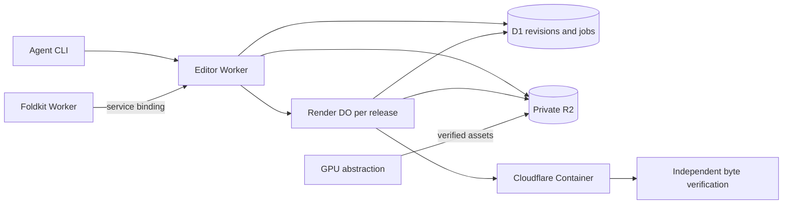

# Editor architecture decision

This document describes the Cloudflare editor. The standalone Rust editor is a separate application.

## Usage first

The agent discovers schemas and feature progress. The agent edits a validated project and commits the project at an expected revision.
The agent starts a render with a stable intent ID. The agent polls the actual job and verifies the stored output bytes.
The agent records review evidence separately.

The CLI is a client of the Cloudflare editor, not a local editor daemon.
The CLI supports offline checks of schemas and projects without cloud credentials.

```sh
bun run editor -- tools
bun run editor -- schema project
bun run editor -- validate project.json
bun run editor -- progress
bun run editor -- call project.commit request.json
bun run editor -- call render.start request.json
bun run editor -- call render.status request.json
bun run editor -- call artifact.verify request.json
bun run editor -- archive JOB_ID release-kit.zip
```

Credentials come from environment/private configuration. Callers never submit
tenant IDs, machine paths, arbitrary URLs, shell commands or FFmpeg graphs.

`kit.locate` returns a source-bound descriptor for a ready six-output render.
`GET /v1/jobs/:id/archive` streams private R2 media as a ZIP64 archive.
The stream verifies SHA-256 and CRC for one entry at a time.
Cloudflare `FixedLengthStream` establishes the exact HTTP content length.
Cancellation stops the active source read and leaves later entries unopened.

The manifest names measured outputs and separate artifact-bound review records.
It includes an editable project checkpoint with private media references.
The archive contains no source-media copies or internal workstation paths.

The Studio derives the current Editor job from the completed release receipt.
Its private `/api/releases/:id/archive` route checks tenant ownership, attempt, and all six ready assets.
Then, the route forwards the request through the Editor service binding.
The Editor checks the release binding again. Archive downloads do not schedule renders or invoke the GPU abstraction. The CLI checks every entry through an
independent Python ZIP reader and refuses to overwrite current destinations.

## Grounding

The current Foldkit Website Worker owns tenant sessions, frozen release briefs,
D1 job attempts and private R2 media. The original prototype invoked the GPU
abstraction and then hard-coded Mac Resolve at `agent/production.ts`.
Current schema-v2/v3 plans use the separate Editor Worker through its service
binding. The editor accepts a serializable project revision or measured recipe.
Historical Resolve plans remain evidence and cannot resume production.

The local app is untracked. Thus, Git history cannot establish the original design rationale. The supplied conversation records the change from local Resolve to a
separate Cloudflare Worker. Native codec execution belongs in Cloudflare
Containers because the Worker isolate is constrained. That is an architecture
conclusion from the platform documentation, not evidence of a successful render.

## Selected shape

Candidate A is the base: immutable project documents with D1 atomic revisions,
idempotent render intents and one container-backed Durable Object per release.
D1 is the only mutable project/job authority. R2 stores source/output
bytes and immutable receipts. The render DO coordinates ephemeral execution. The render DO does not own an alternate project database.

One D1 capacity slot bounds native rendering and cold verification across this
Editor deployment. Queued render actors register durable waiters. Admission rotates between tenants with queued work. Admission keeps FIFO order in each tenant.

Queued jobs consume no native Container. Queue time does not consume the
execution deadline. The acquired grant starts that deadline.

Each grant binds the tenant, job, recipe fingerprint, purpose and unique token.
Only confirmed native termination permits release of the same grant.
Unknown outcomes retain the grant until reconciliation or explicit cancellation.
Queued cancellation leaves another tenant's active Container unchanged.

Cold verification competes for the same slot and returns `render_capacity_busy`
with HTTP 503 and `Retry-After`. The agent retries only this verification result while its production lease remains live.
The helper does not retry render starts or unknown failures. Verification has no durable fairness queue.

The slot limits this Editor's D1 namespace. It does not cap account spend or
coordinate other Cloudflare applications. Local two-tenant runtime evidence is
saved in [capacity-runtime-receipt.json](capacity-runtime-receipt.json).

The public interface has a schema-discoverable tool call and read-only queries for capabilities and progress. Pure project validation and the edit reducer own frame bounds, source identity, coverage, native script, and effect restrictions. Storage hides
tenant predicates, optimistic writes and intent deduplication. The native renderer receives bounded recipes. Tenants cannot submit commands.



## Design comparison and synthesis

The rubric covers the deployment boundary, deep agent interface, tenant/revision/retry invariants, six-output evidence, and integration complexity.
The parent scores each criterion out of five. Candidate A received `5,4,4,5,5`. Candidate B received `5,5,5,5,3`.

Candidate B's per-project actor gives a total event order. Candidate B requires an outbox,
an eventually consistent D1 index and log compaction. Those add substantial invariants for the current one-click product. Reject that second
project authority. Add B's edit-batch reducer, explicit unsupported-feature errors, artifact-bound reviews, and attempt-fenced reconciliation to A.

Use a render DO only where Cloudflare's container lifecycle requires one. Keep
the project's source of truth in D1. Future live collaboration can add event order without changes to immutable revisions or byte-bound render receipts.

The independent cross-judge scored A 23/25 and B 22/25 and selected A. The design adopts its corrections. Uniqueness is `(tenant, intent)` with fingerprint comparison. A release has one active render fence. The fence includes uncertain jobs. The release-scoped DO attaches a deterministic job and reconciles before replay.

Kit promotion requires the exact six-output record. Partial draft composition arrays remain useful while an agent edits. Engine capability
receipts distinguish declared code from the actual deployed engine.

## Implementation boundaries

- `editor/project.ts`: schema, edit reducer, timeline and kit validation.
- `editor/catalog.ts`: tool schemas and feature ledger.
- `editor/store.ts`: tenant-scoped revisions, intents, jobs and evidence.
- `editor/api.ts`: bounded HTTP tools and credential-derived authorization.
- `editor/worker.ts`: independently deployed Worker entry.
- `editor/render-object.ts`: container lifecycle, scoped media transfer and recovery.
- `editor/capacity.ts`: shared D1 admission, tenant rotation and exact grant release.
- `editor/engine/`: native renderer, verifier and container image.
- `agent/editor-cli.ts`: JSON client and offline validation.
- `agent/editor-request.ts`: lease-bound production requests and cold-verification backoff.

## Acceptance and tradeoffs

Optimistic conflicts are preferable to unintended replacement of edits. Render recipes bind the
exact revision and canonical media. Unknown outcomes require reconciliation. Timeouts cannot fabricate success or trigger duplicate native execution. Native
engine support and cloud verification are reported separately. Machine QC cannot establish full watch/listen or creative acceptance.

1. Start with complete validation of projects and commands.
2. Run isolation tests.
3. Run native canaries.
4. Read actual cloud results.

The ledger records broader Resolve parity per feature. The editor's name does not imply that parity.
