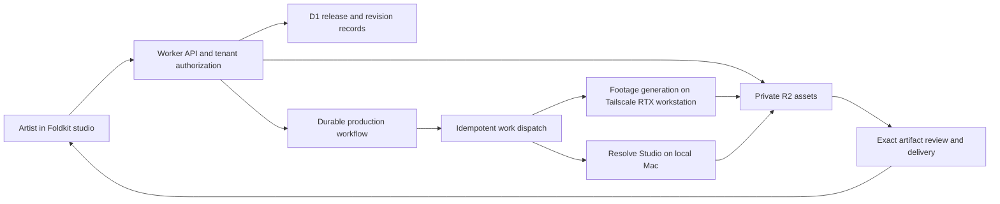

# From local director to Release Kit

This document records the earlier Resolve-based product and cloud plan. It does not describe current standalone Rust implementation status.

The first customer is an AI music creator with frequent releases. The product promise is a finished release kit from one song: a full cinematic music video, three vertical promos, thumbnail, and square artwork. Cinematic direction, expressive native-script lyrics, and music response are combined in the film. A recurring artist identity makes the next release easier.

The recommendation for the initial product is a release kit with a bounded revision allowance. Credits or a recurring allowance can follow measured production costs. Before you set prices, measure dollars per accepted scene and per delivered kit. Include rejected generations, setup, Resolve rendering, storage, and revision work.

## Customer journey

1. Create an artist identity once.

   The identity includes a recurring world, palette, music-response intensity, and reference assets.

2. Supply the finished song and exact original-script lyrics.

   Audio analysis, alignment, and the creative treatment run automatically behind the creation action.

3. Examine the job stages and time range.

   The stages show actual progress. Actual queue/worker measurements determine the time range. A useful preview appears when a real artifact exists.

4. Review the film and individual formats.

5. Leave a note against a time range.

   The service returns a targeted revision. It retains accepted shots and the original master.

6. Download the verified kit.

Social publication is a separate product action and authorization.

The current frontend implements device-local draft preparation and illustrative format review. Cloud rendering, authenticated tenancy, uploads, billing, and final artifact delivery remain future backend work.

## Stack boundaries

| Layer                      | Responsibility                                                                                                              |
| -------------------------- | --------------------------------------------------------------------------------------------------------------------------- |
| Foldkit + Effect           | Artist-facing state, forms, review, typed messages and commands                                                             |
| Cloudflare Worker + Effect | Authenticate requests, enforce tenant membership, validate schemas, authorize uploads/downloads, reserve production budgets |
| D1                         | Tenants, memberships, artists, releases, immutable revisions, jobs, receipts and artifact metadata                          |
| Private R2                 | Audio, source assets, generated footage, project snapshots and verified exports                                             |
| Cloudflare Workflows       | Durable orchestration of external generation/render jobs and review events                                                  |
| Queues                     | Work dispatch and controlled retries, with duplicate delivery handled explicitly                                            |
| GPU generation worker      | Footage generation on the RTX 4070 Ti workstation                                                                          |
| Resolve finishing worker   | Lyric/environment composition, editing and rendering on the local Mac                                                      |
| Alchemy                    | Stage-scoped infrastructure and deployment configuration                                                                    |

[Cloudflare Workflows](https://developers.cloudflare.com/workflows/) supports durable steps, retries, and waits for external events. Use it as the durable coordinator. Run typed Effect services inside each step. Keep GPU generation and Resolve outside the Worker that serves requests.

## Tenancy and job contracts

The authenticated session determines the tenant and actor. Never trust a tenant ID supplied by a browser as authority. Every release, revision, job and artifact lookup includes tenant membership and ownership. Object prefixes alone are organization, not authorization.

Use short-lived upload/download capabilities only after permission checks. [R2 presigned URLs](https://developers.cloudflare.com/r2/api/s3/presigned-urls/) provide bounded object access, while the API remains responsible for validation of permissions and completed uploads.

Keep the durable entities small: tenant → artist → release → immutable revision → production job → artifact. A release revision binds the canonical audio hash, lyric/cue hash, treatment version, accepted shot lineage and export preset. Production attempts reference that revision rather than a mutable directory or the newest filename.

[Queues can deliver a message more than once](https://developers.cloudflare.com/queues/reference/delivery-guarantees/). Each external job needs a persisted intent, idempotency key, attempt ID, provider receipt and recoverable output path. On timeout, reconcile a possible submission before a retry. Lease the Resolve worker to one job with a fencing token.

A stale attempt cannot promote exports or overwrite the current project. Treat payment/credit reservations and releases as idempotent ledger entries too.

Use real states: draft → queued → analyzing → directing → generating → composing → rendering → verifying → ready. Failed, canceled and awaiting-input are explicit terminal/intervention states. “Ready” requires exact exported files plus technical and perceptual review. The customer's revision creates a new revision and invalidates only affected dependents.

## First production proof

Pal Pal Nimisham's exact 239.68-second selected WAV is the pilot. Its external workspace holds a 23-asset input snapshot and a planned kit record. Prior lyric timings and 17 stylized anchors require fresh validation. The frontend photograph is sample artwork and supplies no film treatment authority.

The user selected the existing workstation over Tailscale for generation and clarified that Resolve is installed on the local Mac. Herdr reaches the saved `WSL box.` machine. Inference stays on its native Linux filesystem and existing RTX 4070 Ti runtime. Verified generated originals are transferred to the Mac with their hashes preserved.

Resolve Studio 21.1's local scripting connection edits and renders them in a separate project. Reserve the remote GPU and Mac Resolve independently. Before you switch projects, save/checkpoint the project you leave.

Tailscale connects the operator and generation host. Cloudflare Workers must not assume access to a private tailnet. The recommendation is that product workers on both hosts claim authenticated jobs through outbound API connections.

These workers then download narrowly scoped assets and report receipts. Keep Resolve and ComfyUI interfaces private.

Those outbound product agents are proposed architecture, not part of the deployed preview.

Live readback confirmed the Mac's Studio product/version and scripting connection. Select one representative generated-motion scene with native Telugu lyric composition and measured audio-driven environment response. Prove that scene through exact Resolve exports and picture/audio review. Record script-return status separately from exported-picture correctness. Measure that path before a full kit or concurrent tenants.

No rented GPU is needed or authorized for this pilot.

Pilot completion requires exports and verification of all six real outputs. It also requires a full-film watch/listen, actual provider reconciliation, and closure of run-owned billing resources. This document and the functional frontend do not establish that production proof.
