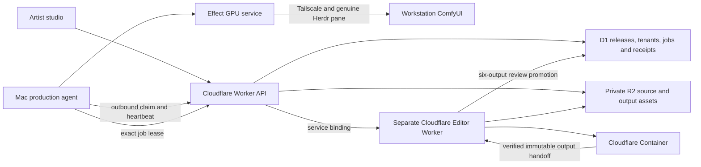

# Hosted studio and hybrid production worker

This document describes hybrid production with the historical Cloudflare editor. It does not report current standalone Rust implementation status.

The customer uses a Foldkit/Effect app on a Cloudflare Worker. Alchemy declares
the Studio Worker, separate Editor Worker, native Cloudflare Container, D1 and
private R2. The current hosted URL still serves the earlier frontend preview. OAuth permissions are now saved.

Deployment requires Workers Paid and R2
activation. Approval for the new subscriptions and usage budget remains pending.

The browser never receives a workstation address or worker token. The service consumes each studio invitation once. It returns a hashed, expiring HttpOnly session tied to a server-owned tenant.

Operator and worker device credentials are separate. Same-origin checks protect cookie-authorized mutations.

Device credentials are kept in ignored mode-600 files.

Every submission freezes a source SHA-256, duration, exact native lyrics and artist direction. Request keys deduplicate retries. A worker claims a durable job atomically, receives a fenced lease, and reports progress and provider receipts. Expired attempts cannot publish artifacts.

Completion commits the job, release and all six artifact records in one database transaction.

The service stores artist profiles under the authenticated tenant. Each save requires an expected revision. Conflicts between saves preserve browser edits and require explicit reload.

A new one-time invitation can return to the same tenant without a new studio. Studio, authentication attempt, and edit generation constrain async profile responses.

Release readback displays the immutable brief independently of the editable studio profile.

Audio streams into R2 through a fixed-length stream with checksum validation. The native editor independently verifies stored artifacts and persists an
immutable receipt. The production bridge derives tenant/release from the live
device lease. It validates the receipt and frozen source, then promotes the six
R2 objects atomically into review.

Unfinished assets stay private. The full-song 1080p film, three vertical promos, landscape thumbnail and square
artwork are all required. Review does not mean creative acceptance.

The GPU service exposes probe, ensure, submit, status, reconcile and collect. The first adapter uses the saved Tailscale SSH route and an explicit Herdr pane. The remote runner rejects an unmanaged host and verifies frozen graph bindings. It acquires the shared GPU lease and preserves submission intent before inference. `ensure` reconciles an existing intent.

It never treats a lost response as permission to resubmit. Before final composition and render, the agent checks the original transfer and complete decode.

The earlier Resolve driver remains historical evidence. Its six-format diagnostic
stalled in a native Fusion lock. The application and reservation were preserved. The earlier 3.875-second Resolve pilot passed technical verification.

The current
production adapter uses schema-v2 measured projects or schema-v3 generated-media recipes and Cloudflare post-production. Legacy
Resolve plans cannot resume through the supervisor.

The Mac agent is installed as an outbound launchd service, with a one-job CLI. It polls assigned holds and queued work every 20 seconds. Direction and review
holds preserve attempts. A reviewed schema-v2 or schema-v3 plan can resume only through the
worker-owned transition that checks the complete brief.

Reconciliation holds
remain excluded from automatic resume. The updated Mac service runs and prepares direction-v2 packets. Hosted
configuration remains pending deployment. Arbitrary new-song direction, billing,
production identity providers, quotas and retention remain work.

A plan file
cannot stand in for listening or creative acceptance.

The worker renews ownership throughout transfers and production. It interrupts local I/O if renewal fails. It checks ownership once more before completion. Large file transfers and readback use streamed hashes with bounded multipart buffers. Herdr RPCs share a reservation for each workstation/pane. Uncertain responses preserve the request until its exact terminal response is reconciled.

These protections are implemented and tested locally. They do not establish a finished release or hosted production readiness.

Direction preparation is automatic after source verification. This also applies to already assigned direction holds. A private, atomically committed packet binds the job/release, complete artist brief, canonical source, and exact native lyric lines. It also binds the measured analysis hash. Repeat polls reuse artifacts that match without a new claim. This step computes response curves and coarse beat candidates.

It does not infer heard song sections or approve a storyboard. The six deliverable requirements and pending listening/pilot gates accompany the packet. Local text models and Whisper caches are available on the workstation. A model-backed director and audiovisual reviewer remain unverified.

## Evidence

- `local-api-receipt.json`: native Alchemy D1/R2 invitation isolation, exact 46 MB canonical upload and queued release.
- `web-worker-receipt.json`: a real API claim, worker source download with the same hash, and live GPU provider probe.
- `gpu-provider-receipt.json`: recovery and transfer of the known original without new inference.
- `storage-receipt.json`: actual multipart storage, corrupted-part rejection, exact readback and rejection of a short film as a full release.
- `resolve-automation-diagnostic.json`: native stall and scope of the preserved, unfinished diagnostic.
- `worker-reliability-receipt.json`: 24 successful checks, live streamed source claim, original recovery through the reserved transport, and the boundary of the unfinished kit.
- `service-install-receipt.json` and `service-runtime-receipt.json`: live launchd registration, repeated API polls without another held-job claim, worker isolation, rejected changed-brief resume and diagnostic credential revocation.
- `artist-profile-receipt.json`: native D1 studio isolation, revision conflicts, invalid identity rejection, and return sign-in that preserves the saved identity.
- `browser-worker-receipt.json`: actual browser-created release, independently hashed worker source, exact native lyrics and immutable tenant readback, with a first-attempt direction hold.
- `app-verification-receipt.json`: current checks and desktop/mobile browser evidence.
- `direction-handoff-receipt.json`: The installed service prepared both actual Pal Pal submissions and full-song measured analysis. It preserved the held attempts, retained exact frozen inputs, and recorded explicit pending creative gates.

These receipts cover the local native bindings. Hosted end-to-end production and the full Pal Pal kit remain pending.

The schema-v3 recipe binds every planned shot without a prediction of its output hash. It checks full composition coverage before inference and before a held plan resumes. After collection, hashes and stream metadata come from actual files. The immutable project follows the same leased editor route.

The local generated-media canary passed fifteen checks and submitted no GPU inference. See `editor/generated-production-runtime-receipt.json`.

The local audio-model canary and known speech/silence calibration passed. All
239.68 seconds reached the model. A separate execution-host audit checked every
decoded range and rejected six numeric observations. Musical interpretation
remains unverified.

The model cannot resume direction holds or approve generation. Fixed audio/speech operations now use the existing Effect GPU abstraction and
reserved transport. A real speech operation and its inference-free replay passed. Optional held-job preparation is implemented but disabled in the installed
configuration.

Source-bound Whisper timing qualification also failed. Canonical
Telugu lyrics remain unchanged. See
[director implementation](director-implementation.md),
[complete coverage](audio-perception-complete-coverage.json),
[transport](gpu-observation-transport-receipt.json) and
[speech qualification](speech-evidence-qualification.json). 
