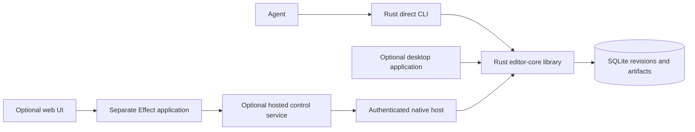

# Standalone Rust editor architecture

The product is a standalone Rust editor with DaVinci Resolve feature behavior as its reference.
Agents can use the Rust library or the direct Rust agent CLI.
Release Kit is one optional workflow.

## Product boundary

The native product owns edit semantics, local project state, native media work, artifact integrity, and the direct agent protocol.
The Rust library is independently usable without a process wrapper, JavaScript, or a UI.
The Rust CLI provides the process boundary for agents that need JSON requests, deadlines, and exit codes.

Effect and UI adapters are separate future applications.
They can call generated Rust schemas or coordinate hosted workflows.
They do not own timeline semantics, native artifact receipts, or direct SQLite access.

## Crates and modules

The workspace has two runtime crates and one development crate.
The split keeps the process contract outside the reusable library and keeps development checks outside runtime dependencies.

| Crate or module | Current source facts and responsibility |
| --- | --- |
| `editor-core` | Process-free typed commands, project and timeline validation, immutable revisions, SQLite transactions, native PNG output, receipts, and artifact verification |
| `editor-cli` | `native-editor` arguments, strict JSON parsing, schemas, discovery, progress, demos, deadlines, response framing, and exit codes |
| `editor-cli/tests` | Actual-process acceptance and independent artifact byte checks |
| `editor-devcheck` | Development-only source policy, bounded subprocesses, architecture checks, current-build checks, evidence reports, and CORE intent comparisons |
| `crates/editor-core/src/project.rs` | Project IDs, frame rates, intervals, timelines, clips, edits, and command input types |
| `crates/editor-core/src/store.rs` | Project directories, SQLite transactions, immutable revisions, stable intents, recovery, and path checks |
| `crates/editor-core/src/frame.rs` | Solid RGBA evaluation, deterministic PNG bytes, renderer identity, and artifact receipts |
| `crates/editor-cli/src/protocol.rs` | Request and response envelopes, schema generation, duplicate-key rejection, limits, and capability discovery |

The public library boundary is `Editor::execute(Command) -> Result<Execution, EditorError>`.
The library returns typed results and errors.
The library does not parse process arguments or terminate its caller.
The CLI calls that boundary and owns process behavior.

Keep storage details inside `editor-core`.
Keep process details inside `editor-cli`.
Keep verification process control inside `editor-devcheck`.
Share a module only when it does not create a new knowledge boundary.

## Current implementation

The compiled registry contains six tools.
They are `engine.capabilities`, `project.create`, `project.inspect`, `project.commit`, `frame.render`, and `artifact.verify`.

The P0 frame model has one visual track with procedural solid RGBA sources and no clip overlap.
The current renderer writes CPU PNG frames.
The current state model supports local projects, stable intents, immutable revisions, recovery records, and source-bound artifact receipts.

The ledger contains 81 feature families.
Eight CORE families are `implemented`, and 73 families are `planned`.
The ledger has 74 Rust owners, six Effect owners, and one UI owner.
No ledger entry is `verified` without a current acceptance receipt.

The current P0 implementation does not establish movie codec, audio, Indic typography, layered composition, or GPU behavior.
It does not establish hosted execution, playback, listening, or creative acceptance.
Application-owned queue, preset, and remote workflow records do not establish native counterparts.

## Data and process boundaries

The library binds stable intent identity to `(projectId, intentId)`.
Project revisions are immutable.
The store checks replay before it compares the current revision.
Each project has its own SQLite database and artifact directory.

The CLI accepts one bounded JSON request and writes one response.
The request includes the protocol version, request ID, expected schema hash, tool, and typed input.
The CLI rejects duplicate keys, undeclared fields, unsafe numbers, oversized input, and schema mismatches.
The caller owns the total process deadline and must drain stdout.

The verifier is development-only.
It does not share editing functions as its proof.
It runs architecture and full modes with separate state, logs, and evidence paths.
An incomplete check cannot promote a capability.

## Dependency boundary

The native implementation has no FFmpeg executable path, libav dependency, FFmpeg integration, or hidden fallback renderer.
Unsupported native media requests return structured errors before execution.
The direct CLI does not route to the historical Bun, Python, or Cloudflare editor.

The Rust library can later support native codecs, audio, typography, color, GPU composition, and extended Resolve behavior.
Each addition needs a behavior contract, a versioned reference corpus, and acceptance evidence.

## Optional application boundary

The future application can adapt the Rust process contract or coordinate hosted work.
The future application cannot create a second timeline reducer.
An application adapter cannot claim native capability state or native acceptance evidence.
Hosted execution needs authorization, tenant isolation, cancellation, and recovery tests.

## Optional Release Kit profile

Release Kit accepts a canonical song, native-script lyrics, and an artist profile.
Its profile targets one 1920 by 1080 film and three 1080 by 1920 promos.
It also targets one 1920 by 1080 thumbnail and one 1920 by 1920 artwork file.
The profile also requires source hashes, a duration check, output measurements, byte verification, playback, listening, and creative review.
Those requirements apply to the workflow profile.
They do not define the general editor API or the native P0 gate.

Use [docs/SPEC.md](SPEC.md) for the full protocol, storage, identity, acceptance, and optional profile contract.
Use [docs/HISTORY.md](HISTORY.md) for archived design and review records.
