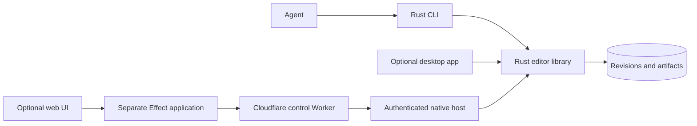

# Standalone Rust editor ownership

The native editor is a Rust library and a direct Rust agent CLI.
The user separated Effect and UI from the editor on 2026-10-04.
You can build and use the editor without JavaScript or a UI.
[PROGRESS.md](PROGRESS.md) records runtime evidence separately from this design decision.

## Caller experience

A local agent discovers the available tools and schemas.
The agent then invokes the Rust binary.
The same binary creates projects, commits edits, renders PNG frames, and verifies registered artifacts.
A Rust application embeds `editor-core` and submits typed commands without a separate process.

The library returns typed results and errors. It does not terminate its caller or parse process envelopes.
The CLI watchdog limits execution and result selection.
The caller drains stdout and controls the total process timeout.

One owner writes the terminal response.
This ownership prevents duplicate protocol documents or arbitrary truncation.

## Ownership

| Owner | Responsibilities |
| --- | --- |
| `editor-core` Rust library | Timeline types, semantic validation, revisions, intents, SQLite transactions, pixels, PNG, receipts, and artifact verification |
| `editor-cli` Rust binary | Arguments, strict JSON framing, schemas, discovery, executable identity, deadlines, demo, progress, and exit codes |
| `editor-devcheck` development binary | Repository guardrails, bounded check processes, isolated targets, current-build acceptance, evidence auditing, and reports |
| Separate future application | Optional Effect orchestration, React or Tauri UI, remote adapters, authentication, and deployment |

The library owns one `Editor::execute(Command)` boundary that hides internal details.
The storage module keeps SQLite rows private.
The process module keeps process envelopes private.
A UI cannot query the project database directly or reimplement timeline edits.
Generated schemas expose the Rust command contract to future adapters.
Before publication, a TypeScript adapter must pass its own schema compatibility and type-generation checks.

## Rust-first comparison

The new arena compared [one package with library and binary](arena/rust-first-a.md)
and [a library and CLI workspace](arena/rust-first-b.md).
A read-only `gpt-6-sol` judge scored both actual artifacts.
Only GPT models are available in this session.
The review uses an independent agent. It does not use a different model family.

| Criterion | One package | Separate crates |
| --- | --- | --- |
| No JavaScript or UI runtime requirement | 5 | 5 |
| Process-free reusable library boundary | 4 | 5 |
| Current command and recovery contract | 2 | 5 |
| Minimal maintainable surface | 5 | 3 |
| Real local acceptance | 4 | 5 |
| Total | 20 | 23 |

The workspace uses two runtime crates. This structure keeps CLI dependencies outside the library.
Acceptance integration tests belong in `editor-cli/tests`. They do not need a third runtime crate.
The design uses typed retry guidance from the single-package candidate.

The single-package candidate placed CORE-07 outside Rust. That choice conflicts with the updated requirement for a Rust-owned lifecycle.
Its stdin-only convenience command also omitted the specified file-input operation.
The same `call` operation supports both input forms. A separate server command is not necessary.

## Development verification boundary

The later guardrail arena selected a separate `editor-devcheck` package over an integrated editor subcommand.
The workspace has two runtime crates and one development crate.
The development crate does not import either runtime crate. Runtime crates cannot depend on the development crate.
The development crate examines actual CLI responses and artifacts. It does not use shared editing functions as its own proof.

The verifier exposes fixed architecture and full modes.
Architecture mode checks repository structure. Full mode also builds and exercises current P0 behavior.
Each run owns separate reports, logs, and state. It also keeps default targets separate from test-hook targets.

The verifier controls subprocess groups and deadlines. It never operates on a production project.
Missing required tools and incomplete checks produce nonzero results.

Rust enforces language-level types and visibility. The separate development package isolates dependencies for development tools and process coordination.
The development package also compares actual feature outcomes with declared expectations.
Feature intent means creator purpose. It differs from the `intentId` used for command replay.
The [intent verification contract](INTENT-VERIFICATION.md) connects scenarios, named cases, observations, and remaining human review.

[GUARDRAILS.md](GUARDRAILS.md) records the comparison and enforcement scope.
[VERIFICATION.md](VERIFICATION.md) describes the actual local commands and evidence.

## Module map

| Module | Knowledge hidden |
| --- | --- |
| `crates/editor-core/src/project.rs` | Validated project types, rational rate, bounded intervals, snapshots, and edits |
| `crates/editor-core/src/store.rs` | Per-project transactions, immutable revisions, replay, and recovery |
| `crates/editor-core/src/frame.rs` | Deterministic pixels, native PNG, measured artifacts, and durability |
| `crates/editor-core/src/lib.rs` | Typed command execution and error contract |
| `crates/editor-cli/src/main.rs` | Direct CLI, process framing, deadlines, and presentation |
| `crates/editor-cli/tests/` | Actual-process acceptance and independent byte checks |
| `crates/editor-devcheck/` | Development policy, subprocess ownership, check verdicts, and fresh evidence |

During implementation, modules can share a path if they do not need separate knowledge boundaries.
The first frame model remains one non-overlapping track of solid RGBA clips.
Native movie codecs, audio, Indic shaping, GPU composition, and complete release kits remain later milestones.

## Invariants retained

Rust owns project-scoped stable intents and immutable revision content.
The replay check occurs before the current-revision comparison. Changed content under one intent fails.
Each project has a separate SQLite database and artifact directory.

The store commits a pending render before work starts. A bounded render holds the SQLite write lock until completion.
Before recovery adopts incomplete output, it compares regenerated deterministic bytes.
Completed corrupt evidence fails. The renderer does not regenerate that evidence silently.

The verifier finds the stored receipt by project and artifact IDs. Callers cannot supply an expected hash.
FFmpeg executables, libav dependencies, bindings, and hidden fallback renderers remain prohibited.

## Programmability boundary

Agents automate editing through the direct Rust CLI. Rust callers use the typed library API.
Future UI and script adapters call the same authority. They cannot create a second timeline reducer or access SQLite directly.
The planned Rust evaluator calculates animation-expression parameters from declared inputs.

An optional Lua host belongs outside `editor-core`. Lua is not a native editor dependency.
The editor does not implement an embedded Lua runtime or Resolve scripting compatibility.
[SCRIPTING.md](SCRIPTING.md) separates workflow automation, expressions, and optional scripting.

## Future application boundary

React, Tauri, and Foldkit remain choices for a future application.
The future application can use Effect to adapt the process contract or coordinate workflows. Effect has no ownership inside the native editor.
Alchemy remains the planned infrastructure tool. D1 and private R2 remain hosted-product adapters.

A Worker isolate cannot execute a native Rust subprocess. Native execution uses a separate host.
P6 must prove hosted authorization, durable revision storage, tickets, cancellation, and tenant isolation.
The local SQLite store does not provide hosted tenant authorization.

## Earlier design evidence

The original [candidate A](arena/candidate-a.md) and [candidate B](arena/candidate-b.md) established Rust domain authority.
Their Effect CLI examples are historical. This Rust-first decision replaces those examples.
The earlier comparison selected A, then adopted a compact command interface and per-project SQLite.
The rationale remains useful. The Effect wrapper is no longer mandatory.
