# Native picture masks grounding A01

Status: grounding complete. This document traces the current read-only runtime before mask candidate drafting. It records no mask API choice and makes no runtime changes.

## Overview

The native editor has one public Rust aggregate, `Project`, and one direct CLI caller. The CLI commits immutable Snapshot 1 revisions, prepares an immutable export plan, runs a bounded native export, and reopens the receipt for product verification. Picture motion already occupies Plan schema 5. Masks are not implemented.

The existing layered path is `Project::export` -> `movie::write` -> `layers::decode` -> per-track workers -> `composition::Mapping` -> `Raster` -> Q16 compositor -> `movie::encode_frames`. A future mask must enter this owned path as a source-bound, validated coverage value. It must leave opaque source BGRA semantics, historical plan bytes, source ordinals, source PTS, output PTS, audio bindings, and export ownership unchanged when no mask is authored.

## Key concepts

- `Snapshot` is the persisted project aggregate. It is schema 1 and owns settings, measured assets, lineage, canonical audio, and timelines.
- `VideoClip` is the authored picture item. It owns a timeline span, source span, cadence, optional framing, optional static placement, and optional `PictureMotion`.
- `ExportPlan` is the persisted execution document. It records schema, immutable source closure, ordered `VideoUse` values, audio uses, timeline sample frames, renderer identity, and decode evidence.
- `VideoUse` is the execution mapping. It records `presentation_ordinals`, `allowed_source_samples`, framing, and either static placement or normalized schema-5 motion.
- `Mapping` converts an opaque source image into a sparse fitted raster. Its `Bounds` are the visible intersection with the destination canvas.
- `Raster` owns BGRA bytes and bounds. `Permit` accounts for its logical payload until the raster is consumed.
- `ExportControl` is the shared cancellation and lease state. `Signal` adds worker stop state and a deadline.
- `ArtifactReceipt` binds the final movie hash, bytes, project revision, plan, renderer, and native measurements. `verify_export` performs fresh product-library readback; a separate observer is needed for separate-code evidence.

## How it works

```mermaid
flowchart LR
  cli["crates/cli/src/main.rs"] --> project["Project::commit / prepare_export / export"]
  project --> snapshot["Snapshot 1 + Snapshot::validate"]
  snapshot --> plan["plan::compile + central mapping validation"]
  plan --> layers["movie::write -> layers::decode"]
  layers --> workers["bounded track workers"]
  workers --> map["motion::resolve + Mapping::rasterize"]
  map --> blend["composition::blend_cancellable"]
  blend --> writer["movie::encode_frames / AVAssetWriter"]
  writer --> receipt["verify -> receipt -> product reverify"]
```

### 1. Public caller, revision, and Snapshot validation

`apps/video-studio/crates/cli/src/main.rs:9-94` parses the direct operations. `project.commit` calls `Studio::open`, `Studio::project`, then `Project::commit` at `crates/editor/src/project.rs:393-509`. `project.prepare-export` calls `Project::prepare_export` at `project.rs:242-277`. `project.export` calls `Project::export` at `exports.rs:757-947`. The same CLI exposes `project.verify-export` and `project.cancel-export`.

`Project::commit` computes the request hash, reopens the requested base revision, and checks that the current head still equals that base. It stages each import through `Studio::stage`, which hashes the bytes, probes the media, and stores a read-only content-addressed blob. It then overlays canonical audio and timelines, sets `snapshot.parent`, calls `Snapshot::validate`, hashes the complete Snapshot, and appends the revision inside a transaction. There is no separate normalized Snapshot object. The normalization boundary is the validated aggregate plus the motion normalization performed during validation.

`Snapshot::validate_cancellable` at `crates/editor/src/model.rs:435-665` enforces Snapshot schema 1, settings, asset-key identity, lineage acyclicity, source ranges, timeline IDs and extents, per-track non-overlap, picture source kind, framing, placement, cadence, audio ranges, and audio clock. When a clip has motion, it calls `motion::normalize_motion_cancellable` with the clip-local frame length at `model.rs:554-566`. It does not require every video frame to have visible content; export-plan compilation owns that stronger coverage rule.

### 2. Plan compilation and central validation

`Project::prepare_export` first replays an existing intent if its request hash matches. Otherwise it loads the measured revision, calls `plan::compile` at `crates/editor/src/plan.rs:96-383`, validates pixel extents, runs `movie::verify_inputs`, attaches decode evidence, computes the plan document hash, verifies every closure blob, and stores the plan in SQLite. A replayed plan is still checked for schema, document hash, project identity, pixel extents, and source bytes.

`plan::compile` calculates the integer audio endpoint with `Rate::samples_at_frame`. It walks timeline tracks in order. For every movie clip, it derives `presentation_ordinals` from `MediaDescriptor::Movie.samples` and the clip cadence. Source-presentation cadence requires a source sample whose PTS equals the source origin plus the local output frame offset. Held images use ordinal zero. The source closure includes every used asset and recursively includes lineage sources.

The current schema selector is explicit at `plan.rs:351-363`: any authored motion selects schema 5; otherwise layered motion-free placement selects schema 4; an image source selects schema 3; the remaining cut path selects schema 2. `VideoUse` is declared at `plan.rs:28-43`.

For schema 5, an animated use carries `motion` and no `placement`. A static use in the same schema carries `placement` and no `motion`. The plan stores independent normalized curves, not a dense frame table. `normalize_motion` validates local keys, defaults missing properties from the base placement, evaluates every local frame, and preserves signed integer positions, unsigned extents, final holds, and Q16 opacity.

`plan::validate_picture_mapping_cancellable` at `plan.rs:397-627` is the central execution check. It rebuilds a temporary Snapshot from the plan timeline and source closure, then calls `Snapshot::validate_cancellable`. It compares ordered tracks and clips, source ranges, framing, normalized placement, normalized motion, and the number of presentation ordinals. It checks each ordinal against `clip.source_samples`, then reads the selected sample from `plan.source_closure[&use_.asset].descriptor.samples`. It verifies source PTS against the cadence clock. There is no `plan.timeline.samples` field and no check against one.

The same validator requires schema 5 to contain declared motion, preserves legacy placement rules for schemas 2-4, checks exact audio-use order, and rechecks the plan audio endpoint. A mask must eventually participate in this same compare-and-recompile boundary. A field that is only checked inside a worker would be a plan-tampering gap.

### 3. Source probing and owned BGRA input

`media::probe` at `crates/editor/src/media.rs:39-46` uses `with_track` for movie and audio imports. `with_track_cancellable` at `media.rs:65-209` canonicalizes the owned path, identifies the container header, creates an `AVURLAsset`, loads exactly one selected track asynchronously, and runs the supplied operation inside an Objective-C completion callback and autorelease pool. The callback captures only `Send` Rust values. `AVAssetTrack`, `AVAssetReader`, sample buffers, and pixel buffers remain callback-confined.

`inspect_track` at `media.rs:234-397` builds the measured movie sample index from output PTS, duration, DTS, and encoded timing. `decode_first` requests `kCVPixelFormatType_32BGRA` and records the first decoded dimensions. Full source decode evidence is separate in `movie::verify_inputs` at `movie.rs:846-962`.

Static PNG input goes through `image::decode_asset` at `crates/editor/src/image.rs:35-135`. It verifies the content hash and byte count, requires a complete non-animated eight-bit stream, expands grayscale and RGB forms, computes the source RGBA hash, swaps red and blue, and returns internal BGRA bytes. Any decoded alpha below 255 is rejected. Movie `Pixels::copy` at `crates/editor/src/pixels.rs:51-83` copies each native row while respecting the native stride and checks the 32BGRA format. `Mapping::rasterize_cancellable` independently rejects any source pixel whose alpha is not 255.

Therefore current picture input means opaque eight-bit BGRA. PNG alpha is an import validation failure, not a transparent layer. The internal byte order is `[B, G, R, A]`; alpha is always 255 after successful import and rasterization. A mask must be a separate coverage concept or a separately specified mask representation. It cannot silently reinterpret existing PNG alpha.

### 4. Layer workers, sparse tracks, gaps, and motion

For Plan schemas 4 and 5, `movie::write` chooses `layers::decode`; schemas 2 and 3 retain `decode_timeline` and the older full-canvas framing path. `layers::decode` begins with `composition::preflight_cancellable`, creates one shared `Budget`, creates one `Signal`, and starts one worker per nonempty video track at `crates/editor/src/layers.rs:398-467`.

Each track owns a capacity-one request channel and a capacity-one response channel. The compositor sends the requested timeline frame to every track. `run_track` at `layers.rs:184-347` returns `Decision::Gap(frame)` when that track has no clip at the requested frame. A clip must start exactly at the requested boundary. Static PNG pixels are decoded once under a serialized PNG mutex and held across the clip. Movie readers are opened inside `media::with_track_cancellable`; the callback advances monotonically through `presentation_ordinals`, checks each decoded PTS against the immutable descriptor sample, copies the native image to Rust-owned BGRA, and sends only the evaluated decision.

`layers::frame` at `layers.rs:136-174` resolves the local placement before it constructs `Mapping`. `motion::resolve` at `crates/editor/src/motion.rs:333-343` rejects a local frame outside the clip and requires exactly one of normalized motion or static placement. `PlannedPictureMotion::evaluate` resolves x, y, width, height, and opacity independently. Linear curves use one signed `i128` complete-value calculation and nearest-away rounding. Step curves hold the left value. Missing properties use the base placement. The final key holds through the clip endpoint.

The compositor's `check_decision` at `layers.rs:350-396` verifies timeline frame, clip, asset, ordinal, source PTS, and resolved placement against the plan before accepting a source decision. It accepts a gap only when the ordered sparse track has no active use. This protects sparse tracks without changing source selection.

### 5. Crop, fit, signed clipping, and raster ownership

`composition::Mapping::new` at `crates/editor/src/composition.rs:101-204` validates source and canvas extents, requires explicit `Framing` when dimensions differ, converts normalized crop to source pixels, and calculates `Contain`, `Cover`, or `Stretch` scales. `Contain` centers fitted content and can leave bars. `Cover` expands the scale and crops. `Stretch` uses independent x and y scales.

The destination x and y are signed `i32`; width and height are positive `u32`. `Mapping::new` computes content edges before clipping. Its intersection clamps visible bounds to the canvas. Negative placements are therefore valid and produce only their visible intersection. Source sample coordinates are pixel-center bilinear coordinates clamped to the retained crop's source-pixel range. `rasterize_cancellable` uses the current formula `crop + ((destination_pixel + 0.5 - content_edge) / scale) - 0.5`, clamps source coordinates, interpolates B, G, and R, rounds each channel, and writes alpha 255.

The mapping returns `None` for no visible intersection or zero Q16 opacity. Otherwise it returns a sparse `Raster` containing only visible bounds. It never allocates a full layer-sized canvas for a clipped or contained layer. `framing::apply` at `crates/editor/src/framing.rs:69-153` is different: it produces a full destination canvas initialized to opaque black and is retained for the legacy cut path. That output cannot be reused for sparse overlays because its contain bars are already opaque pixels.

The shared compositor canvas is allocated in `layers::decode` at `layers.rs:469-489`. It starts as black BGRA with alpha 255. Contain bars have no coverage from that layer, so they expose the current lower-track canvas: they remain black only where no earlier layer contributes. Current sparse rasters blend bottom-to-top. Contain bars are not mask coverage. A sparse layer with no visible bounds contributes no raster. `composition::preflight_cancellable` treats a frame with no visible content as uncovered and rejects it, even if a timeline clip exists. A frame may have a gap on one track when another track supplies visible content.

### 6. Compositing and current Q16 arithmetic

`composition::blend_cancellable` at `composition.rs:345-387` checks canvas extent, raster bounds, raster size, and opaque raster alpha. It blends only channels 0..2. For each channel it computes:

`(input * weight + canvas * (65536 - weight) + 32768) / 65536`.

The weight comes from `Opacity::weight` at `composition.rs:41-56`, which rounds authored `f64 * 65536`. Motion stores the checked integer in `OpacityQ16` at `motion.rs:42-70`. The resolved Q16 value is converted back to an `Opacity` only at the existing blend call, where the exact integer/65536 value maps back to the same Q16 weight. Alpha remains 255.

Mask coverage combination, mask-edge sampling, inversion, and the rounding order between mask coverage and layer opacity are unresolved design questions. They must be specified before changing this opaque-only blend contract.

### 7. Native writer, callback ownership, and verification

`movie::write` at `crates/editor/src/movie.rs:165-215` validates the native profile, opens the bounded PCM stream, and creates a capacity-one frame channel for schemas 4 and 5. It starts one Rust decoder worker. The calling thread enters `objc2::exception::catch` and an autorelease pool, then runs `encode_frames`.

`encode_frames` at `movie.rs:465-654` creates `AVAssetWriter`, H.264 video and AAC audio inputs, and a BGRA pixel-buffer adaptor. It appends frames in immutable timeline order. Each video PTS is constructed as `CMTime::new(video_frame * frame_rate.denominator, frame_rate.numerator)`. Each PCM chunk carries its first sample as a 48 kHz timestamp. It marks each input finished at its declared endpoint, ends the session at `timeline_sample_frames / 48000`, and waits for the native completion handler. The current session start is `CMTime::new(0, 24)`; its value is numerically zero, so it does not introduce a frame-clock offset. The per-frame PTS calculation remains the plan clock.

Native objects do not cross the Rust decoder channels. `media::with_track_cancellable` owns the Objective-C completion callback, and its reader callback uses `ReaderGuard` to cancel the reader on scope exit. `movie::write` closes the bounded receiver before cancellation on failure, interrupts the shared control, and joins the Rust worker before returning. `WriterGuard` cancels an unfinished writer on drop. The only cross-thread picture payloads are Rust-owned `Pixels`, `Raster`, permits, and scalar observations.

After staging, `Project::export` calls `movie::verify_owned`, hashes the stage, writes an immutable `ArtifactReceipt`, checks the epoch and cancellation flag, hard-links the stage into the content-addressed artifact path, and marks the attempt complete. `Project::verify_export` at `exports.rs:549-600` reopens the stored plan and receipt, rechecks source blobs, and invokes product `movie::verify`. `movie::verify_inner` at `movie.rs:1059-1184` checks encoded tracks, reopens every output video sample as BGRA, verifies epoch-zero output PTS and dimensions, reaches video EOF, and compares reopened PCM to the selected source interval. This product verification shares the implementation. A separate observer must be used for independent mask pixel evidence.

### 8. Admission, barriers, and cancellation

`composition::preflight_cancellable` at `composition.rs:401-542` centrally validates the picture map, requires one to four nonempty tracks, and computes frame-local source plus raster charges. Schema 5 evaluates every local pose. Legacy layered plans use an event sweep over clip intervals. The estimate adds three canvas charges, peak active source/raster charges, and a conservative PNG temporary allowance. It rejects estimates above `MAX_ADMITTED_BYTES` (512 MiB). Each owned source, raster, temporary decode, and canvas then gets a `Budget::reserve` permit. `pixels::extent` limits every owned source and canvas frame to 128 MiB. The evidence explicitly excludes allocator, AVFoundation, encoder, and whole-process peak memory.

`Workers::finish` at `layers.rs:54-73` drops request and response ports before joining workers. `Workers::Drop` sets the stopped flag, closes both channel sides, and joins remaining workers. `layers::send`, `receive`, and `request` at `layers.rs:90-120` poll with cancellation checks rather than blocking forever. The compositor consumes each current raster before sending its canvas to the output channel. The output channel is capacity one, and `encode_frames` retains a pending frame until the native input is ready. This is the current backpressure barrier across workers, compositor, and writer.

`ExportControl::check` at `exports.rs:385-417` observes cancellation, lost lease, and interruption states. The lease worker renews the database claim every ten seconds. `Project::cancel_export` records `cancel_requested`; the lease worker then changes the shared control state. The control is checked while preparing, decoding, waiting on channels, rasterizing, blending, appending, verifying, and promoting. `media::wait_for_result` cancels native loading on a failed check or deadline. Epoch and state checks before promotion prevent an old worker from publishing a new attempt's artifact.

## Mask integration seam without a schema regression

The safe seam is the existing source-bound execution path: authored data belongs on the immutable picture item, plan compilation normalizes it into the corresponding `VideoUse`, central validation compares the normalized value with the Snapshot, and `layers::frame` evaluates it beside the resolved placement. The mask's owned coverage should then be sampled with the same explicit crop/fit and signed-canvas rules, carried as an owned bounded raster, and applied before or during `blend_cancellable`.

This is a seam, not a selected contract. The mask task still must choose the mask family, coordinate domain, source binding, edge rule, inversion, opacity combination, alpha precision, and fully masked-frame policy. It must also decide whether a mask-bearing plan needs a new schema. The current selector has no mask branch. The compatibility requirement implies that absent masks must preserve the current schema 2/3/4/5 selector and serialized bytes, while an authored mask must be represented by a new explicitly validated execution shape rather than being silently inserted into an old plan.

Any mask payload must enter `source_closure` and the import measurement boundary if it is a file. Its source bytes, decoded mask extent, per-frame mask raster, and temporary decoder memory must be included in preflight and `Budget`. A mask must not use an unaccounted native buffer or an unbounded dense timeline table. The worker must keep native mask objects callback-confined and send only copied Rust-owned coverage data.

## Persisted fixtures to preserve

The masks fixture manifest is `apps/video-studio/docs/design/masks-legacy-fixtures-a01.json`, SHA-256 `cf3ccb32ea68a58532a312c921024107fcc3773b9f2cc68dd7ddab5ba0b6695f`. It records exact bytes extracted from the preserved SQLite state before masks implementation.

- `apps/video-studio/crates/editor/tests/fixtures/legacy/snapshot-schema1-motion.json`: 410865 bytes, SHA-256 `1947fcb6939dbec40f13ae23b87a156f5d6e1758fa18e058aaa1f810abc313d3`.
- `apps/video-studio/crates/editor/tests/fixtures/legacy/plan-schema5.json`: 415912 bytes, SHA-256 `8ca51e03d048971a86cb598990fabd2f93f839c98b1b6c5fda3eb7aa90c3ee06`.
- `apps/video-studio/crates/editor/tests/fixtures/legacy/plan-schema2.json`: 369279 bytes, SHA-256 `97fdd9f63d48ee3b600ee37a845c302e79815bd1870b20dae376f9c4a957e025`.
- `apps/video-studio/crates/editor/tests/fixtures/legacy/plan-schema3.json`: 4983 bytes, SHA-256 `4e5a89b00e7b5fabaafb4bf1335c1a5c3538c593765b4f5e5c818ff6bcede219`.
- `apps/video-studio/crates/editor/tests/fixtures/legacy/plan-schema4.json`: 413967 bytes, SHA-256 `5cf0320f82bfc19839c5a06ffec15449fcdb80b97be15e2b4fb4105517ef0687`.
- `apps/video-studio/crates/editor/tests/fixtures/legacy/receipt-schema2.json`: 1418 bytes, SHA-256 `44c0c27ad1a58f22746011673d8e4d4a211c5b5cdeffcb18172d6cc73fc73be2`.

The plan schema 5 and Snapshot schema 1 motion fixtures are the direct masks compatibility anchors. The schema 2/3/4 plans and schema 2 receipt guard the older paths and immutable output identity. A masks implementation must assert exact file bytes and hashes before testing new behavior.

## Next masks test needs

1. Add independent pure vectors for each chosen mask family. Cover full and empty coverage, inversion, edge clamping, crop/fit, contain bars, signed clipping, zero and full opacity, overlap order, and Q16 tie rounding.
2. Keep mask coverage separate from opaque source alpha. Test opaque RGB, RGBA with alpha 255, rejected translucent PNG, and any new mask representation independently.
3. Add Snapshot and plan tests for absent-mask byte compatibility, new-schema selection when a mask is authored, unknown-field rejection, source-closure identity, normalized mask comparison, unchanged presentation ordinals, and unchanged source PTS.
4. Add sparse-track cases with gaps, a fully masked frame, a zero-opacity layer, negative placement, a clipped overlap, and a contain-bar intersection. State whether a fully masked picture frame is rejected or covered by another layer.
5. Add bounded ownership tests for mask source bytes, mask rasters, temporary decode payload, capacity-one channels, blocked sends, PNG serialization, native callback failure, cancellation, worker shutdown, and permit release.
6. Run an actual native fixture through a separate observer. Bind all mask/source files, plan, receipt, producer, output bytes, output PTS, video EOF, audio EOF, and fresh source-clock comparisons. Keep product `verify_export` and separate-code evidence distinct.

## Gotchas and current scope limits

- `framing::apply` and `composition::Mapping` implement different contracts. The first emits a full opaque canvas; the second emits sparse fitted bounds. A sparse mask must follow the latter contract.
- Opaque input is enforced twice for layered pictures: PNG decode rejects non-opaque alpha, and rasterization rejects any non-255 source alpha. No current layer carries a fractional alpha plane.
- A zero-opacity or fully clipped mapping has no visible bounds. Timeline span alone does not satisfy preflight's visible coverage requirement.
- Source PTS execution checks read `source_closure[asset].descriptor.samples`. Presentation ordinals are immutable source choices, not compositor frame numbers.
- Motion is normalized once into schema 5 and resolved per local frame. A mask that changes per frame must use the same bounded local-frame discipline.
- Logical payload admission is not a maximum native-memory proof. The current limit covers application-owned source, raster, canvas, and configured PNG allowance only.
- The current writer has one measured 48 kHz stereo PCM clip, unity gain, and zero pan. Masks must not add audio behavior.
- Rotation, general transforms, alpha-bearing picture inputs, text, managed color, and creative playback acceptance remain outside the current implementation scope.
