# Native mastering dependency grounding A01

Status: traced from the current Rust editor and retained A01 evidence on 2026-10-06.

This document completes the grounding phase only. It does not select a public profile, audio format, schema change, or proof implementation.

## Overview

The editor currently has one output profile: H.264 video and AAC audio in an MP4 container.

The profile enters through `ExportRequest`. It is copied into the immutable `ExportPlan` and therefore changes the plan hash.

The writer, filename extension, receipt validation, and technical verifier still encode the H.264 contract separately.

A mastering profile must make those sites agree. The existing Project operations and export lifecycle can remain intact.

The observed H.264 failure is narrow. Structural video, audio, clock, and EOF checks pass for the retained mask fixture.

The fixed 34 dB RGB policy fails fractional mask strips and exposed lower-layer regions. A 24 Mbps H.264 probe keeps the same failures.

ProRes 4444 in QuickTime is a plausible native dependency. Current bindings expose the required symbols.

A saved host query accepts the proposed settings. It does not prove a combined write, BGRA ingestion, or decoded fidelity.

```mermaid
flowchart LR
    A[ExportRequest plus MovieProfile] --> B[plan::compile]
    B --> C[immutable ExportPlan plus plan_id]
    C --> D[Project::prepare_export]
    D --> E[epoch claim and owned stage]
    E --> F[bounded picture and PCM workers]
    F --> G[AVAssetWriter staged movie]
    G --> H[native track and full decode verification]
    H --> I[output hash plus receipt]
    I --> J[finalizing epoch check]
    J --> K[read-only content-addressed artifact]
    K --> L[completed replay or verify_export]
    I --> M[finalizing recovery]
    M --> H
```



## Key concepts

### Output profile

`MovieProfile` is the caller-visible output contract. The current type has one tagged variant.

```rust
#[serde(tag = "kind", rename_all = "snake_case", deny_unknown_fields)]
pub enum MovieProfile {
    H264AacMp4 {
        video_bitrate: u32,
        audio_bitrate: u32,
    },
}
```

`ExportRequest` contains the profile. `ExportPlan` stores the same typed value.

Both documents use canonical JSON hashing. Therefore, the request hash and `plan_id` bind the selected output profile.

Source: `crates/editor/src/plan.rs:10-26` and `crates/editor/src/plan.rs:54-71`.

### Identity chain

The export has several different identities. Each identity answers a separate tamper question.

| Identity | Current owner | Meaning |
| --- | --- | --- |
| revision hash | snapshot document | Exact authored project state |
| request hash | `ExportRequest` | Intent, revision, timeline, and profile |
| `plan_id` | `ExportPlan` | Normalized timeline, sources, profile, renderer, and decode evidence |
| renderer identity | `BuildIdentity` | Executable, lockfile, host, architecture, and native backend |
| output SHA-256 | staged file bytes | Exact encoded artifact |
| receipt ID | `ArtifactReceipt` document | Plan, renderer, output, and technical measurements |
| verification ID | `ArtifactVerification` document | Fresh verifier identity and measurements |

The output profile is direct in the request and plan. Receipt schema 2 binds it indirectly through `plan_id`.

### Stage and artifact

The stage is owned by `(project, intent, epoch, owner_pid)`. It is temporary and mutable only by that attempt.

The final artifact is content-addressed by output SHA-256. It becomes read-only after a successful hard-link promotion.

The current stage and final filenames both hardcode `.mp4`. Those paths form part of receipt validation.

### Technical measurement

`NativeMeasurements` records decoded coverage and track observations. It is not a color-detail measurement.

It records these values:

- video and audio sample counts;
- output width and height;
- complete video decode status;
- output codec FourCC values;
- raw track PTS ranges;
- audio rate and channel count;
- two-channel audio correlation;
- optional bounded PCM streaming evidence.

It does not record these values:

- container UTI or file brand;
- configured or measured bitrate;
- chroma sampling or bit depth;
- color primaries, transfer function, or matrix;
- exact profile-specific writer settings;
- region fidelity against the pre-encode picture reference.

Source: `crates/editor/src/movie.rs:656-734`.

## Current A01 evidence boundary

The authored fixture SHA-256 is `969e22d77c0d5d2bb8aee5693254d9e17c2d06797b8ceac8f891c7f7d2aa7f04`.

The fixed policy SHA-256 is `ba5f639c4c2c94f1cc307057bf99758bfcedb8deee61181d7da46fc1182f736f`.

The reference manifest SHA-256 is `35e196ef8c041714b3eca714ca600deb9c158605fc308a9a85288bc3d1d6e011`.

The ROI manifest SHA-256 is `2531487be1e4e18927e88865c6e0afd982dff075e1fb7c679489781045ba6c4f`.

The reference contains 72 frames at 320 by 180 and 24 fps. It covers four picture tracks and one 48 kHz stereo audio track.

The original 6 Mbps H.264 checks contain 1,366 nonempty region comparisons across two audio variants.

They contain 58 failures. Twenty are `fractional_strip` failures, and 38 are `hidden_region` failures.

The minimum full-frame PSNR is 36.119824 dB. The minimum fractional-strip PSNR is 28.762885 dB.

The minimum hidden-region PSNR is 30.794945 dB. Other retained region classes remain above 34 dB.

The declared 24 Mbps probe uses the unchanged synthetic revision, reference, ROI coordinates, and 34 dB threshold.

That probe contains 683 nonempty comparisons and 29 failures. Ten are fractional strips, and 19 are hidden regions.

Its minimum full-frame PSNR is 36.239533 dB. Its two failed minima are 28.748407 dB and 30.800039 dB.

The probe output SHA-256 is `a5c52104ccfc686e5cead70d97b5f09f9afd3fd4a4684ae373f8403feb2d5748`.

Its `plan_id` is `308b6ae9aa83c6a587824def27e727ab2b53f72acc606bb86cc46a97cf2b5aae`.

The reopened tracks remain `avc1` and `aac `. The output has 72 video frames and 144,000 audio sample frames.

The retained SPS prefix reports profile 100, `chroma_format_idc` 1, and eight-bit luma and chroma.

That SPS observation applies to this output only. It does not establish a universal H.264 limitation.

Higher H.264 bitrate did not repair the observed unit. The evidence supports testing a full-chroma mastering path.

None of this evidence establishes `WATCHED`, `HEARD`, creative acceptance, final-film suitability, or maximum performance.

Evidence locations:

- `artifacts/scratch-video-goal-20261005/native-project-a01/masks-native-unit-a01/parent-picture-preliminary-a01.json`
- `artifacts/scratch-video-goal-20261005/native-project-a01/masks-native-unit-a01/profile-probe-a02-policy.json`
- `artifacts/scratch-video-goal-20261005/native-project-a01/masks-native-unit-a01/bitrate-probe-picture-a02.json`
- `artifacts/scratch-video-goal-20261005/native-project-a01/masks-native-unit-a01/h264-sps-a01.json`

## How it works now

### 1. The caller selects the profile

The CLI deserializes caller JSON and invokes the same typed Project operations.

The public lifecycle is `prepare_export`, `export`, `cancel_export`, `verify_export`, and `reconcile_export_staging`.

No codec-specific public operation exists. That boundary can remain generic.

The current JSON profile is:

```json
{
  "kind": "h264_aac_mp4",
  "video_bitrate": 6000000,
  "audio_bitrate": 192000
}
```

### 2. The compiler normalizes and binds the request

`plan::compile` validates the revision and timeline. It validates H.264 and AAC bitrate ranges in a profile match.

The accepted video range is 100,000 through 100,000,000 bits per second.

The accepted audio range is 64,000 through 512,000 bits per second.

The compiler then builds the source closure, exact `presentation_ordinals`, audio uses, and timeline sample count.

Plan schema selection currently follows picture semantics. Masks select schema 6, motion selects 5, and layers select 4.

Images select schema 3. Simple movie cuts select schema 2.

The output profile does not currently select the plan schema.

The compiler copies `request.profile` into the plan before hashing it.

Source: `crates/editor/src/plan.rs:98-130` and `crates/editor/src/plan.rs:370-403`.

### 3. Preparation proves source closure and stores the plan

`Project::prepare_export` first tries an exact request-hash replay.

A fresh preparation verifies all source blobs. It compiles the snapshot and validates pixel extents.

It then opens every selected movie or image source. It records scoped decode evidence in the plan.

The method recomputes `plan_id` after adding evidence. It verifies the source closure again before storage.

The final plan is stored transactionally by project and intent.

Replay accepts plan schemas 2 through 6. Replay rejects a changed request hash or plan document.

Source: `crates/editor/src/project.rs:242-320`.

### 4. Export claims an epoch and creates an owned stage

`Project::export` reruns preparation and validates the native composition.

The export table serializes ownership by project and intent. A changed request on the same intent is a conflict.

A live owner keeps its epoch. A dead or expired owner yields to the next epoch.

The lease renews every 10 seconds. Each renewal extends the claim by 240 seconds.

The current executable must match the renderer stored in the plan.

`ExportStage::create` writes and syncs `owner.json`. The stage directory key hashes project, intent, and epoch.

The current payload path is always `movie.mp4`.

Source: `crates/editor/src/exports.rs:757-853`, `crates/editor/src/exports.rs:385-474`, and `crates/editor/src/export_stage.rs:18-75`.

### 5. Bounded workers feed one native writer

`movie::write` opens one bounded PCM stream and starts one picture decoding coordinator.

Schema 4 through 6 use a composed-frame channel with capacity one. Older paths use capacity two.

Layered picture execution starts one worker for each nonempty track. Preflight permits one through four tracks.

Each track has one request slot and one response slot. The coordinator consumes tracks in authored bottom-to-top order.

The PCM channel has capacity two. Each owned PCM chunk contains at most 4,096 stereo sample frames.

Picture preflight limits the logical Rust payload estimate to 512 MiB. Each owned BGRA frame is limited to 128 MiB.

The estimate includes configured PNG allowance. It excludes total process and native-framework memory.

The writer receives opaque 32BGRA frames. The compositor sets canvas alpha to 255.

Source: `crates/editor/src/movie.rs:165-215`, `crates/editor/src/layers.rs:411-547`, and `crates/editor/src/pcm.rs:21-175`.

### 6. `encode_frames` supplies the H.264 contract

`encode_frames` creates `AVAssetWriter` with `AVFileTypeMPEG4`.

It requests video codec string `avc1`. It supplies width, height, and `AVVideoAverageBitRateKey`.

It requests audio format ID `0x61616320`, which is `aac `. It supplies 48 kHz, two channels, and bitrate.

It requests 32BGRA input pixel buffers through `AVAssetWriterInputPixelBufferAdaptor`.

The method calls `canApplyOutputSettings` for both tracks. It then calls `canAddInput` for both inputs.

The current order starts the PCM and picture workers before these native availability checks.

The writer starts a session at zero. Video PTS values come from the plan frame rate.

Audio input samples are interleaved, little-endian, 32-bit float LPCM at 48 kHz.

The writer finishes through a callback. The callback sends only `()` through a Rust channel.

The finalization wait is 30 seconds. The stream deadline is 1,800 seconds.

Source: `crates/editor/src/movie.rs:363-463` and `crates/editor/src/movie.rs:465-654`.

### 7. Native verification runs before hashing and promotion

`inspect_encoded_track` reopens each track without decompression settings. It reads the encoded codec FourCC and raw PTS range.

For audio, it also reads the measured rate and channel count.

`verify_inner` currently requires `avc1` video and `aac ` audio.

It requires the planned video sample count, duration, audio layout, dimensions, and exact frame PTS sequence.

It decodes every video frame to 32BGRA. It requires AVAssetReader to reach `Completed` after exact coverage.

Audio verification decodes source and output to 48 kHz stereo float PCM.

It requires continuous chunks, exact sample coverage, and at least 0.99 correlation per channel.

The correlation error text says AAC. The streaming comparison itself can consume any supported output decoder.

Source: `crates/editor/src/movie.rs:736-840` and `crates/editor/src/movie.rs:964-1184`.

### 8. The receipt precedes promotion

The staged file is synced after native verification. Sources are reverified before the output is hashed.

`ArtifactReceipt` schema 2 stores project, revision, `plan_id`, renderer, output path, output hash, byte count, and measurements.

The receipt is stored as an immutable, content-addressed JSON document.

The export moves from `running` to `finalizing` with that receipt. This transition checks the epoch and cancellation flag.

A second transaction checks cancellation and the epoch immediately before promotion.

Promotion hard-links the stage to `artifacts/<output-sha256>.mp4`. The final file becomes read-only.

An existing destination is accepted only after exact hash and byte verification.

The export becomes `completed` only after promotion and artifact-directory sync.

Source: `crates/editor/src/exports.rs:20-32` and `crates/editor/src/exports.rs:844-947`.

### 9. Replay and recovery repeat technical verification

`verify_export` joins the export and plan rows. It rehashes the plan and reconstructs the request from the plan profile.

It requires the plan and export request hashes to match. It rechecks the revision and every source blob.

`read_artifact` requires receipt schema 2 and an exact content-addressed `.mp4` path.

`verify_artifact` hashes the output, reruns native verification, and compares fresh measurements with the receipt.

A completed export call follows the same artifact verification path.

Recovery can reclaim a dead or expired `finalizing` attempt. It reads the immutable receipt under a new epoch.

If the promoted output exists, recovery verifies it before marking completion. Otherwise, export renders a fresh stage.

Stage reconciliation removes only known files from a terminal or abandoned owned stage.

Source: `crates/editor/src/exports.rs:548-755`, `crates/editor/src/exports.rs:757-843`, and `crates/editor/src/exports.rs:948-1017`.

## Native mastering feasibility

### Compile-time framework access

The locked `objc2-av-foundation` 0.3.2 bindings expose `AVFileTypeQuickTimeMovie`.

They also expose `AVVideoCodecTypeAppleProRes4444` and `AVVideoCodecTypeAppleProRes4444XQ`.

The locked Core Media bindings define ProRes 4444 as FourCC `ap4h`.

The locked Core Audio bindings define linear PCM as FourCC `lpcm`.

These symbols establish API access only. They do not establish usable encoder support on this host.

Apple describes ProRes 4444 as supporting full-resolution 4:4:4 RGB or Y'CbCr and optional alpha.

ProRes 4444 is visually lossless under its intended use. It is not a mathematically lossless pixel container.

Primary references:

- [Apple ProRes 4444 codec type](https://developer.apple.com/documentation/avfoundation/avvideocodectype/prores4444)
- [Apple QuickTime movie file type](https://developer.apple.com/documentation/avfoundation/avfiletype/mov)
- [AVAssetWriter settings availability](https://developer.apple.com/documentation/avfoundation/avassetwriter/canapply%28outputsettings%3Aformediatype%3A%29)
- [Core Audio linear PCM](https://developer.apple.com/documentation/coreaudiotypes/kaudioformatlinearpcm)
- [Apple ProRes white paper](https://www.apple.com/final-cut-pro/docs/Apple_ProRes_White_Paper.pdf)

### Measured host settings query

The saved query ran as standalone Rust on Darwin arm64, macOS 26.0.1.

Its manifest SHA-256 is `f9ee98981347fcf559957e2d9b2f2e954344f53cde74d2f11f3585057d6274cd`.

Its report SHA-256 is `5849d71eb7a359e1215ceb0bb8d190a6be0ea536b92ee528fc117e51cf848193`.

The query used the same `objc2` and AVFoundation crate versions as the editor.

It tested these three settings groups:

| Label | Container | Video | Audio | `canApply` | Individual `canAddInput` |
| --- | --- | --- | --- | --- | --- |
| control | MPEG-4 | `avc1` | AAC 192 kbps | both true | both true |
| mastering option | QuickTime | `ap4h` | AAC 192 kbps | both true | both true |
| mastering option | QuickTime | `ap4h` | 24-bit integer PCM, 48 kHz stereo | both true | both true |

The PCM query declared little-endian, interleaved, non-float, 24-bit output.

The query did not add both inputs to one writer. It did not call `startWriting`.

It encoded zero video frames and zero audio sample frames. It created no media file.

It did not test 32BGRA adaptor compatibility, append behavior, finalization, reopening, clocks, or ROI fidelity.

Evidence locations:

- `artifacts/scratch-video-goal-20261005/native-project-a01/mastering-native-unit-a01/format-probe-settings-a01.json`
- `artifacts/scratch-video-goal-20261005/native-project-a01/mastering-native-unit-a01/format-probe-manifest-a01.json`
- `artifacts/scratch-video-goal-20261005/native-project-a01/mastering-native-unit-a01/format-probe-a01/src/main.rs`

### Current pixel ceiling

The editor owns picture frames as eight-bit BGRA bytes. It creates native `kCVPixelFormatType_32BGRA` buffers.

All current picture inputs and the composed canvas are opaque. The compositor writes alpha 255.

A full-chroma codec could reduce the observed 4:2:0 chroma loss after composition.

It cannot create detail beyond the eight-bit unmanaged BGRA composition it receives.

The current path also carries no explicit color primaries, transfer function, or matrix contract.

Source: `crates/editor/src/pixels.rs:13-128` and `crates/editor/src/layers.rs:482-533`.

### Assumption ownership

The current implementation scatters format assumptions. A later design must give each assumption one authority.

| Assumption | Current owner | Required proof owner |
| --- | --- | --- |
| caller-selected format | `MovieProfile` | typed public profile and immutable plan |
| allowed profile values | `plan::compile` bitrate match | profile-specific compiler validation |
| container UTI | `movie::encode_frames` | native format settings authority |
| video codec and controls | `movie::encode_frames` | native format settings authority |
| audio codec and controls | `movie::encode_frames` | native format settings authority |
| output extension | `ExportStage` and `Project::export` | the same format authority used by stage, receipt, and replay |
| host settings availability | `AVAssetWriter` checks | `canApply`, combined `canAddInput`, start, append, and finish |
| actual encoded codecs | `inspect_encoded_track` | profile-specific verifier expectations |
| track clocks and EOF | `verify_inner` and PCM stream | native verifier |
| output color detail | external A01 ROI policy | independent decoded picture proof |
| artifact identity | output hash and receipt | existing receipt and promotion lifecycle |

The profile author must own the intended container, video codec, audio format, and allowed codec controls.

AVFoundation must own runtime availability. A successful settings query cannot replace an actual write.

The verifier must own observed FourCC values, clocks, EOF, decoded pixels, and audio measurements.

Artifact naming must derive from the same selected format. It must not infer the container from a loose path suffix.

### Audio remains undecided

The current AAC path has actual write and reopened correlation evidence. AAC remains lossy.

The 24-bit PCM settings query succeeded. The current writer has not appended its float PCM input to that output configuration.

The current input sample buffer is 32-bit float LPCM. A PCM mastering path would ask AVAssetWriter for 24-bit integer output.

That conversion and the exact QuickTime track must be written, reopened, identified, and compared before acceptance.

No grounding evidence selects AAC or PCM. That is a candidate-level decision.

ProRes bitrate handling also remains undecided. The current H.264 average-bitrate field must not be copied into ProRes by assumption.

## Hardcoded sites and generic seams

### Sites that require a format-aware decision

| File and lines | Current hardcoding | Consequence for a new format |
| --- | --- | --- |
| `plan.rs:19-26` | only `H264AacMp4` | caller cannot request mastering output |
| `plan.rs:116-130` | H.264 and AAC bitrate ranges | validation assumes both bitrate fields |
| `movie.rs:9-13` | MPEG-4 and H.264 symbols | imports exclude QuickTime and ProRes constants |
| `movie.rs:478-507` | MP4, `avc1`, H.264 bitrate, AAC | writer settings cannot represent another profile |
| `movie.rs:1065-1084` | expected `avc1` and `aac ` | valid mastering tracks would fail verification |
| `movie.rs:1031-1034` | AAC-specific error text | PCM failure would be mislabeled |
| `export_stage.rs:74-76` | stage `movie.mp4` | QuickTime output receives the wrong stage suffix |
| `export_stage.rs:114-129` | cleanup allows only `movie.mp4` | a `.mov` stage would be retained as unknown |
| `exports.rs:671-702` | receipt path must end in hash plus `.mp4` | mastering receipt replay would fail |
| `exports.rs:870-886` | final artifact uses `.mp4` | promotion cannot name QuickTime output correctly |
| `media.rs:82-95` | every `ftyp` header becomes `video/mp4` | a QuickTime file may receive the wrong MIME override |
| `cli/src/main.rs` discovery text | describes H.264 and AAC export | discovery would omit the new supported profile |

The input reader does not validate media by filename extension. It classifies a 12-byte header and overrides AVURLAsset MIME.

Many ISO base media files start with `ftyp`. Therefore, the exact produced QuickTime header and brand need a native readback test.

The stage, final path, cleanup allowlist, receipt validation, and reader classification must agree on `.mov` and QuickTime.

### Code that can stay generic

| Existing seam | Why it is format-independent |
| --- | --- |
| public Project operations | they operate on typed `ExportRequest` and intent |
| request and plan hashing | profile bytes already participate in identity |
| source closure and `presentation_ordinals` | they describe source lineage and clocks |
| picture schema selection | it currently describes picture execution features |
| bounded layer composition | it emits opaque BGRA independently of output codec |
| PCM source worker | it emits exact 48 kHz stereo float chunks |
| epoch claims and lease renewal | they fence attempts independently of format |
| cancellation propagation | it checks export state independently of codec |
| stage ownership document | project, intent, epoch, and PID remain sufficient |
| immutable receipt storage | content-addressing works for any receipt document |
| hard-link promotion order | it depends on verified bytes and current epoch |
| output hash and byte verification | it is container-independent |
| track inspection machinery | it already reports actual FourCC and PTS |
| full decoded video loop | it can decode any AVFoundation-supported output to BGRA |
| PCM clock and correlation loop | it can compare any output decoded to float PCM |
| build identity | it binds the exact native executable and host |

These seams remain generic only when profile-specific expectations are supplied from one trusted format contract.

## Ownership, backpressure, and cancellation fences

### Native object ownership

`media::with_track_cancellable` captures only Send-owned Rust data in its asynchronous callback.

`AVAssetTrack` remains on the callback thread. It never crosses a channel or enters the domain model.

A mutex-held `FnOnce` prevents duplicate callback execution. Cancellation marks the callback before cancelling asset loading.

`ReaderGuard` cancels an incomplete `AVAssetReader` on drop. `WriterGuard` cancels an incomplete writer on drop.

The writer finalization callback sends only a unit value. It does not transfer a retained framework object.

Source: `crates/editor/src/media.rs:65-180` and `crates/editor/src/movie.rs:51-64`.

### Worker and payload bounds

The layered path permits at most four nonempty track workers. Each worker has capacity-one request and response channels.

The composed output channel has capacity one for current layer schemas. The PCM channel has capacity two.

The 512 MiB picture admission number is a conservative application-owned payload estimate.

It is not a maximum total-memory guarantee. Native buffers, decoder allocations, vector capacity, and framework state are outside it.

Changing only the output codec should not remove these limits. New writer buffering must receive separate measurement.

### Cancellation and epoch fences

Worker waits check cancellation every 25 milliseconds. Full stream work has a 1,800-second deadline.

Dropping picture or PCM owners closes channels, sets stop signals, and joins their threads.

A write failure interrupts the shared export control before joining the picture worker.

The lease control rejects cancellation, lost epochs, unavailable leases, and explicit interruption.

The database checks the epoch before `finalizing`. It checks cancellation and epoch again before promotion.

No new format may publish a staged file after cancellation or ownership loss.

## Historical compatibility

The existing fixtures establish exact byte compatibility, not only successful deserialization.

| Fixture | Bytes | SHA-256 |
| --- | ---: | --- |
| snapshot schema 1 | 3,064 | `a4afc9237cdc477ddc0c62023b7e0ed185a9f39bd3f72fd3f6596964d1c82423` |
| placement snapshot schema 1 | 409,983 | `00d8a0eb3bbf0cd6290e68fffaa8c4d8b5a654446fb2220f5d084da17944e1ea` |
| motion snapshot schema 1 | 410,865 | `1947fcb6939dbec40f13ae23b87a156f5d6e1758fa18e058aaa1f810abc313d3` |
| plan schema 2 | 369,279 | `97fdd9f63d48ee3b600ee37a845c302e79815bd1870b20dae376f9c4a957e025` |
| plan schema 3 | 4,983 | `4e5a89b00e7b5fabaafb4bf1335c1a5c3538c593765b4f5e5c818ff6bcede219` |
| plan schema 4 | 413,967 | `5cf0320f82bfc19839c5a06ffec15449fcdb80b97be15e2b4fb4105517ef0687` |
| plan schema 5 | 415,912 | `8ca51e03d048971a86cb598990fabd2f93f839c98b1b6c5fda3eb7aa90c3ee06` |
| receipt schema 2 | 1,418 | `44c0c27ad1a58f22746011673d8e4d4a211c5b5cdeffcb18172d6cc73fc73be2` |

`legacy_hashes.rs` deserializes and reserializes each fixture. It requires identical bytes and the recorded hash.

Every historical profile serializes as `h264_aac_mp4`. A new enum variant can leave those bytes unchanged.

That alone does not settle schema policy. The later design must answer two separate questions.

1. Is output format orthogonal to picture execution, so the current plan schema can represent another profile?
2. Do new technical measurements require a new receipt schema instead of optional fields on receipt schema 2?

Old plan schemas 2 through 6 must keep their current H.264 meaning. Old `.mp4` receipts must keep exact path validation.

A generic extension rule must branch from the stored historical profile. It must not reinterpret old output paths.

Receipt schema 2 already binds the profile through `plan_id`. New direct format fields would change receipt bytes and identity.

Source: `crates/editor/tests/legacy_hashes.rs:1-47`, `crates/editor/src/project.rs:279-319`, and `crates/editor/src/exports.rs:671-710`.

## Where things live

| Concern | Current module |
| --- | --- |
| request, profile, normalized plan | `crates/editor/src/plan.rs` |
| preparation and source closure verification | `crates/editor/src/project.rs` |
| writer, output inspection, and native verification | `crates/editor/src/movie.rs` |
| per-track decode workers and ordered composition | `crates/editor/src/layers.rs` |
| picture admission and composition math | `crates/editor/src/composition.rs` |
| owned BGRA buffers | `crates/editor/src/pixels.rs` |
| bounded PCM decode stream | `crates/editor/src/pcm.rs` |
| AVFoundation callback boundary and header classifier | `crates/editor/src/media.rs` |
| stage ownership and cleanup allowlist | `crates/editor/src/export_stage.rs` |
| epochs, receipts, promotion, verification, recovery | `crates/editor/src/exports.rs` |
| executable and native backend identity | `crates/editor/src/identity.rs` |
| exact historical hash tests | `crates/editor/tests/legacy_hashes.rs` |

## Gotchas and unresolved candidate questions

1. `canApplyOutputSettings` is necessary but insufficient.

   The saved query proves only settings acceptance and individual input admission.

2. ProRes 4444 support must be proven through the actual 32BGRA writer path.

   The proof must add both inputs, start, append, finish, reopen, and decode.

3. The format probe does not choose AAC or PCM.

   AAC has current end-to-end evidence. PCM24 has settings-query evidence only.

4. ProRes controls must not inherit H.264 bitrate semantics.

   Apple ProRes is a different encoder family. Its accepted settings require direct native proof.

5. A `.mov` suffix is not sufficient container proof.

   The verifier must inspect the produced file and reject a container, codec, or extension mismatch.

6. `media.rs` maps every `ftyp` header to `video/mp4`.

   The exact QuickTime output brand must be tested before relying on reopened verification.

7. Existing native measurements do not prove the 34 dB region policy.

   The mastering proof must compare decoded output against the unchanged pre-export picture reference and ROI coordinates.

8. A full-chroma output cannot exceed the current eight-bit unmanaged BGRA working image.

   This unit can address output chroma loss. It cannot claim managed color or higher-bit-depth composition.

9. Plan and receipt schema choices remain open.

   The choice must preserve every historical byte while keeping new format expectations tamper-evident.

10. Availability checks currently occur after decode workers start.

    A rejected format still starts bounded work before the writer reports incompatibility.

11. The proof remains technical.

    It cannot establish playback review, listening review, Resolve suitability, creative approval, or final-film acceptance.

The next design phase can compare complete contracts against these traced boundaries. This grounding does not prefer one contract.
