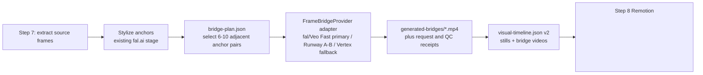

# Frame-to-Frame Video Generation for Remix Phase 2

**Research date:** 2026-08-01  
**Question:** replace the current periodic still-image changes with short, artistic videos that begin on one stylized source frame and arrive at the next.

## Decision

Use a **two-keyframe image-to-video adapter** in Step 7. For this repository, start with **Veo 3.1 Fast through fal.ai**, because the project already uses `@fal-ai/client` and fal-hosted image inputs. Keep **Runway Gen-4.5 as the first independent A/B adapter** and **Google Veo 3.1 directly on Vertex AI as the production-governance fallback / quality alternative**.

All three routes expose a real API and accept a first and a last image. The fal-hosted Veo route is the lowest-friction repository fit and has a dedicated first/last-frame endpoint. Runway accepts image URLs or data URIs and provides a useful independent model comparison. Direct Vertex Veo adds Google Cloud authentication and storage work, but provides stronger first-party operational controls.

Do **not** make a clip for every current image-sequence interval. Twenty 4-second clips are expensive, slow, and visually exhausting. Instead, select 6-10 **anchor-frame pairs** at phrase, drop, or scene-transition moments, generate 4-second bridge shots, and retain stills/Remotion motion for the rests.

## What “frame-to-frame” can and cannot guarantee

The right request is: *use this exact image as the first keyframe, use this exact image as the last keyframe, and invent the motion/camera/action connecting them*. This is substantially better constrained than ordinary image-to-video, but no vendor promises pixel-identical intermediate frames or a pixel-identical final decoded frame.

For edit-grade joins, the renderer should therefore show the real start image for 4-8 frames, play the generated bridge with its first/last 4-8 frames trimmed or crossfaded, then show the real end image for 4-8 frames. The actual anchors, rather than a model approximation, own the cuts.

## Provider comparison

| Provider/model | First + last frame API support | Duration and output | API and operational fit | Published price | Important constraints | Recommendation |
| --- | --- | --- | --- | --- | --- | --- |
| **Veo 3.1 Fast through fal.ai** | **Yes.** Dedicated `first_frame_url` and `last_frame_url` endpoint. | **4, 6, or 8 s**; 720p/1080p; 16:9 or 9:16. | Best fit with the repository's existing `@fal-ai/client`, fal uploads, queue pattern, and credential setup. | **$0.10/s without audio** at 720p/1080p. A 6 s candidate is **$0.60**. | Safety filtering applies; model endpoints and prices can change; provider receipt and model ID must be recorded. | **Repository primary.** Start with one pair, 6 s, three candidates, no generated audio. |
| **Runway Gen-4.5** | **Yes.** `promptImage` can be an array of `{uri, position: 'first' | 'last'}`; the official API version guide includes the two-image request. | Image-to-video duration is **2-10 s**. Gen-4.5 supports 1280x720, 720x1280, 1584x672, 1104x832, 832x1104, 672x1584, and 960x960. | Mature Node/Python SDK, async task API, HTTPS URL/data-URI inputs. Fits a local TypeScript CLI without adding Cloud Storage. | **12 credits/s = $0.12/s** (credits are $0.01). A 4 s candidate is **$0.48**. | 16 MB image URL / 5 MB data-URI limit; URL inputs need HTTPS and valid Content-Type/Length. Inputs are auto-cropped to requested ratio. Moderation includes public-figure controls. | **Independent A/B adapter.** Use it to compare artistic motion and identity preservation against Veo Fast. |
| **Google Veo 3.1 on Vertex AI** | **Yes.** `image` is the start and `last_frame` is the end in the official SDK and REST examples. | **4, 6, or 8 s**, 24 fps, 16:9 or 9:16, **720p or 1080p** (4K is preview-only). | Direct long-running Vertex API, output to Cloud Storage or response bytes; needs Google Cloud auth/project and, preferably, a workspace-scoped GCS prefix. | Veo video without audio is published at **$0.50/s**; 4 s is **$2.00** per candidate. | JPEG/PNG input, safety filtering, English prompts, and image-to-video is governed by Google’s Pre-GA terms. `personGeneration` can allow adults or disallow people/faces. | **Fallback and quality A/B option.** Use where higher-resolution direct output or Google Cloud governance outweigh the extra cost/ops. |
| **Luma Ray 2** | **Yes.** `keyframes.frame0` and `keyframes.frame1` can both be images. | Current docs expose `resolution` values **540p, 720p, 1080p, 4K** and a duration field; the public reference does not state a stable full duration matrix, so validate it against the account/API before committing it to the pipeline. | Async Dream Machine API with callback support. Images must be uploaded to a reachable CDN URL; local data URIs are not the documented route. | No public Ray 2 API rate table found in Luma’s current video/API documentation; treat pricing as account/dashboard-verified. | Keyframe/prompt moderation can reject a job. Looping is not supported for two-image keyframes. | **Secondary fallback only.** It is a valid two-image option but adds image hosting and its current docs point users to a newer Agents API. |
| **Kling VIDEO 3.0** | **Product support: yes.** Kling’s official guide lists Start & End Frames-to-Video, and the product guide says the model can run to **15 s**. Its official Open Platform has an image-to-video endpoint, but confirm the exact enabled model/fields in the account before coding to it. | Kling’s product guides describe 720p/1080p and native 4K options; the exact API entitlement and price vary with input/membership/model. | Official Open Platform exists, but the browser product workflow and its rapidly changing model catalogue make it less predictable than the two APIs above for a first adapter. | Credits are published per feature/model in product guides, not as one durable public API price table for this use case. | **Do not send private/copyright-sensitive frames by default:** its policy says uploads are non-confidential and grants Kling a broad license to use Content, including improvement/training uses (subject to its terms). It also requires rights to inputs. | **Exploration only.** Potentially artistically strong, but not the default for a workspace that extracts third-party YouTube frames. |

### Primary sources

- [fal.ai Veo 3.1 Fast first/last-frame API](https://fal.ai/models/fal-ai/veo3.1/fast/first-last-frame-to-video/api)
- [fal.ai Veo 3.1 Fast pricing](https://fal.ai/models/fal-ai/veo3.1/fast/first-last-frame-to-video)
- [Runway: first/last `promptImage` API contract](https://docs.dev.runwayml.com/api-details/versions/2024-11-06/)
- [Runway: image-to-video API reference](https://docs.dev.runwayml.com/api/)
- [Runway: image input limits and Gen-4.5 output ratios](https://docs.dev.runwayml.com/assets/inputs/)
- [Runway: pricing](https://docs.dev.runwayml.com/guides/pricing/)
- [Google: Veo first-and-last-frame SDK/REST example](https://cloud.google.com/vertex-ai/generative-ai/docs/video/generate-videos-from-first-and-last-frames)
- [Google: Veo 3.1 capabilities and limits](https://cloud.google.com/vertex-ai/generative-ai/docs/models/veo/3-1-generate)
- [Google: Vertex AI pricing](https://cloud.google.com/vertex-ai/generative-ai/pricing)
- [Luma: video/keyframe API](https://docs.lumalabs.ai/docs/video-generation)
- [Luma: keyframe/moderation errors](https://docs.lumalabs.ai/docs/errors)
- [Kling: Start and End Frames](https://home.kling.ai/quickstart/ai-video-start-end-frames)
- [Kling: VIDEO 3.0 model guide](https://home.kling.ai/quickstart/klingai-video-3-model-user-guide)
- [Kling: Open Platform image-to-video API](https://kling.ai/document-api/apiReference%2Fmodel%2FimageToVideo)
- [Kling: user policy and Content license](https://kling.ai/docs/user-policy)

## Recommended Phase 2 architecture



### New, resumable workspace artifacts

```text
bridge-plan.json
generated-bridges/
  <slug>-bridge-001.mp4
  <slug>-bridge-001.request.json
  <slug>-bridge-001.receipt.json
  <slug>-bridge-001-contact-sheet.jpg
visual-timeline.json
```

`bridge-plan.json` is the durable creative brief and should be editable before spending credits:

```json
{
  "version": 1,
  "style_bible": "dreamlike ink-and-neon Telugu music-video world; lush cinematic light; no text or logos",
  "provider": "fal",
  "model": "fal-ai/veo3.1/fast/first-last-frame-to-video",
  "bridges": [
    {
      "id": "bridge-001",
      "start_frame_id": "frame-003",
      "end_frame_id": "frame-004",
      "duration_seconds": 4,
      "render_start_time": 18.4,
      "prompt": "One continuous elegant camera move: the flower garland loosens into luminous ink ribbons, ribbons sweep across the lens, then resolve into the end-frame composition. Preserve the illustrated subject, palette, wardrobe, and lens continuity. No titles, letters, logos, cuts, or extra limbs.",
      "negative_prompt": "text, watermark, logo, jump cut, morphing face, duplicate subject, flicker"
    }
  ]
}
```

`visual-timeline.json` supersedes only the current visual portion of `image-sequence.json`; lyrics, audio-reactive effects, and the cover-art fallback remain unchanged. A segment is either `"still"` or `"bridge"`, so Remotion can choose `` or `<OffthreadVideo>` / `<Video>` deterministically.

```json
{
  "version": 2,
  "segments": [
    {"type": "still", "image_path": "stylized-frames/<slug>-frame-003.png", "start_time": 16.0, "end_time": 18.4},
    {
      "type": "bridge",
      "video_path": "generated-bridges/<slug>-bridge-001.mp4",
      "start_image_path": "stylized-frames/<slug>-frame-003.png",
      "end_image_path": "stylized-frames/<slug>-frame-004.png",
      "start_time": 18.4,
      "end_time": 22.4,
      "head_hold_frames": 6,
      "tail_hold_frames": 6
    }
  ]
}
```

### Adapter boundary

Add `tools/visual-sequence/frame-bridge.ts` and keep provider-specific code behind a small interface:

```ts
type FrameBridgeRequest = {
  startImagePath: string;
  endImagePath: string;
  prompt: string;
  negativePrompt?: string;
  durationSeconds: number;
  outputRatio: "1280:720" | "720:1280";
  candidateCount: number;
  seed?: number;
};

type FrameBridgeProvider = {
  submit(request: FrameBridgeRequest): Promise<{jobIds: string[]}>;
  wait(jobId: string): Promise<{videoUrl: string; providerReceipt: unknown}>;
};
```

- **fal/Veo Fast implementation:** upload the two normalized anchors with the existing fal storage client; call `fal-ai/veo3.1/fast/first-last-frame-to-video`; persist the request ID; poll/wait; download the selected MP4.
- **Runway implementation:** encode the two normalized images as data URIs (or use temporary HTTPS URLs); call `imageToVideo.create` with `promptImage: [{uri, position: "first"}, {uri, position: "last"}]`; poll/wait; download the selected MP4.
- **Direct Vertex Veo implementation:** upload temporary JPEG/PNG assets to a workspace-scoped GCS prefix; call `generate_videos` with `image` and `last_frame`; poll the long-running operation; copy the resulting MP4 into the workspace; delete temporary input objects according to the project retention policy.
- Never put either credential in `meta.json`, request receipts, or commits. Use `RUNWAYML_API_SECRET` or application-default Google credentials / a secret manager.

## Artistic direction: make the connection a shot, not a dissolve

The source frames should be treated as the beginning and end of one visual sentence. The prompt needs to describe the **middle action and camera path**, not merely repeat what is visible in the images.

Use one of these shot grammars, chosen from the pair’s actual visual relationship:

| Pair relationship | Bridge grammar | Example motion instruction |
| --- | --- | --- |
| Same subject, changed pose/location | Motivated camera move | “A slow handheld orbit passes behind the subject’s shoulder and arrives at the end composition.” |
| Different but similarly colored scenes | Material transformation | “The sari fabric becomes a river of ink; the ink folds into the end landscape.” |
| Wide to close | Lens travel | “A continuous deliberate push through drifting jasmine and bokeh into the close portrait.” |
| Close to wide | Reveal | “The camera pulls through a mirror/reflection; the reflection opens to reveal the wide end frame.” |
| Abstract dance/drop | Rhythmic metamorphosis | “On the downbeat, luminous rangoli lines rise, spiral around camera, and settle exactly into the end-frame geometry.” |

Keep a workspace-level `style_bible` shared by every bridge: palette, medium, lens language, texture, and a small exclusion list. Let the per-bridge prompt contain only the motion, causal transition, and endpoint continuity. That preserves the artistic unity previously obtained by using one common stylization prompt.

## Quality, cost, and safety gates

1. **Normalize before generation.** Use the same crop, aspect ratio, and pixel dimensions for both anchors. Avoid asking a 16:9 generator to bridge two differently cropped images.
2. **Plan first, generate second.** Generate no credits until `bridge-plan.json` exists and shows the pair, prompt, timing, and model.
3. **Prove one pair first.** Three 6-second Veo Fast candidates are about **$1.80** at the published no-audio rate. Add one 6-second Runway candidate (about **$0.72**) for an independent artistic comparison. Approve a winner before planning a batch.
4. **Automated technical QC.** `ffprobe` each output for codec, duration, FPS, dimensions, and decodability. Extract first/last frames and compare them with the anchors using a perceptual similarity threshold; flag failures rather than silently accepting them.
5. **Visual QC.** Create a contact sheet showing start anchor, generated first/middle/last frames, and end anchor. Review for identity drift, text/watermarks, flicker, abrupt cuts, or unwanted new characters. The creative selection remains human/agent-reviewed, not fully automatic.
6. **Render joins from the real anchors.** The small head/tail holds described above protect against endpoint drift and make a failed candidate replaceable without touching the rest of the render.
7. **Rights and privacy gate.** Only submit source video frames when the user has the rights/permission needed to transform them and when the provider’s data terms are acceptable. In particular, do not make Kling the default for private or copyrighted inputs given its published Content-license terms. This is separate from the music-video workflow’s normal copyright and likeness review.
8. **Fallback behavior.** If credentials are absent, moderation rejects the request, a job fails, or all candidates fail QC, retain the existing `image-sequence.json` still/crossfade segment. A visual-generation failure must never block Phase 2 rendering.

## Implementation plan

1. Add a `bridge-plan` command that reads `selected-visual-frames.json`, the stylized-frame manifest, remix beat/phrase timing when available, and proposes a sparse set of chronological adjacent pairs. It writes no generated media.
2. Add a `frame-bridge` command with `--provider=fal-veo-fast|runway|vertex-veo`, `--dry-run`, `--bridge=<id>`, `--candidates=N`, and `--resume`. It writes a request receipt before submission and makes retries idempotent by bridge/candidate ID.
3. Implement the fal/Veo Fast provider adapter and test it with fixture requests (unit-test request shape, file naming, polling/error handling, and resume logic; perform one controlled live canary only after credentials are configured).
4. Add the Runway A/B adapter and direct Vertex Veo fallback behind the same interface.
5. Add `visual-timeline.json` validation and teach the Step 8 scaffolder/Remotion layout to render bridge MP4s with the anchor holds. Preserve `image-sequence.json`, cover art, and placeholder fallbacks for backward compatibility.
6. Add a contact-sheet/QC command plus `meta.json` pointers/statuses such as `visual_bridge_plan_ready`, `visual_bridges_generated`, and `visual_bridges_approved`.
7. Render a 20-30 second fixture containing two bridges and inspect the actual MP4 before promoting the feature to the default Phase 2 flow.

## Explicit non-goals for the first implementation

- Generating a bridge for every one of the default 20 frames.
- Replacing the remix audio or relying on provider-generated audio; keep the existing remix as the only audio track.
- Claiming perfect frame identity from a generative model.
- Making any provider mandatory. The existing still-image flow remains a deterministic fallback.

## Local and Chinese-model follow-up

**Research refresh:** 2026-08-01. This follow-up uses only model-owner repositories and fal.ai's own model/API pages. It separates an actual **two-keyframe** model from ordinary image-to-video: a one-image model cannot reliably land on the supplied final frame.

### Updated decision

For the one permitted fal canary, use **ByteDance Seedance 2 Fast** at 720p, 4 seconds, with `image_url`, `end_image_url`, and `generate_audio: false`. It is fal's current ByteDance flagship/fast tier with explicit start/end-frame control and a documented 4-second minimum; expect **$0.97** at its published $0.2419/s rate. Disable its generated audio and retain the remix as the only audio track. This test deliberately favours the requested Seedance artistic quality and endpoint control over the absolute lowest price.

If cost is the deciding factor after this single Seedance proof, use **MiniMax Hailuo-02 Standard** for the next comparison: it is a Chinese-hosted fal endpoint with an optional end frame, 768p/6 s output, and a published **$0.27** cost. Do not call both models for the Zara Zara proof; the one-test limit still applies.

### fal.ai: current Chinese-origin two-keyframe choices

| Model | Exact fal endpoint and frame contract | Published duration / resolution | Published price | Fit for the canary |
| --- | --- | --- | --- | --- |
| **ByteDance Seedance 2 Fast** | [`bytedance/seedance-2.0/fast/image-to-video`](https://fal.ai/models/bytedance/seedance-2.0/fast/image-to-video/api): required `image_url`, optional `end_image_url`, which makes the video transition from the starting image to the ending image. | 4–15 s; 480p or 720p; `auto`, 21:9 through 9:16. | $0.2419/s at 720p; audio costs the same. A 4-second test is about **$0.97**. | **Use for Zara Zara test.** Current Seedance fast tier; direct scene-transition controls, seed, and bitrate mode. |
| **ByteDance Seedance 1.5 Pro** | [`fal-ai/bytedance/seedance/v1.5/pro/image-to-video`](https://fal.ai/models/fal-ai/bytedance/seedance/v1.5/pro/image-to-video/api): required `image_url`, optional `end_image_url`; the latter is explicitly the image the video ends with. | 4–12 s; 480p, 720p, or 1080p; 21:9 through 9:16 plus `auto`. | $1.20 / million video tokens without audio; $2.40 with audio. fal gives a 720p/5 s audio-on example of about $0.26. At 720p/24 fps this works out to about $0.13/5 s or $0.16/6 s without audio. | Lower-cost legacy Seedance route; benchmark it only after the Seedance 2 canary if cost becomes more important than current-model quality. |
| **MiniMax Hailuo-02 Standard** | [`fal-ai/minimax/hailuo-02/standard/image-to-video`](https://fal.ai/models/fal-ai/minimax/hailuo-02/standard/image-to-video/api): required `image_url`, optional `end_image_url`. | 6 or 10 s; 512p or 768p. | $0.017/s at 512p or $0.045/s at 768p; a 768p/6 s output costs **$0.27**. | Cheapest high-enough-resolution alternative with a clear start/end contract; use only as the next A/B, not in this one-test pass. |
| **Kuaishou Kling O1 Standard** | [`fal-ai/kling-video/o1/standard/image-to-video`](https://fal.ai/models/fal-ai/kling-video/o1/standard/image-to-video/api): `start_image_url`, optional `end_image_url`; prompt can name them as `@Image1` / `@Image2`. | 3–10 s. The API page does not publish a resolution selector/output-resolution promise. | $0.084 / s on the model page (about $0.42 for 5 s). | Another inexpensive fallback, but less explicit than Seedance/Hailuo about its output-resolution contract. |
| **Alibaba Wan 2.1 FLF2V** | [`fal-ai/wan-flf2v`](https://fal.ai/models/fal-ai/wan-flf2v/api): current schema uses required `start_image_url` and `end_image_url`. | 81–100 frames at 16 fps (default 81 ≈ 5.1 s); 480p or 720p. | $0.20 per 480p output; $0.40 per 720p output; >81 frames bill 1.25×. | A simple low-cost fallback and substantially cheaper per default 720p clip than Seedance 2 Fast, though it is an older and less flexible model. |
| **Alibaba Wan 2.7** | [`fal-ai/wan/v2.7/image-to-video`](https://fal.ai/models/fal-ai/wan/v2.7/image-to-video/api): `image_url` plus optional `end_image_url`. | 2–15 s; 720p or 1080p. | No rate is published on the current public API page. | Do not select it until an account-side price is confirmed. |

Seedance is hosted inference, not a downloadable/open-weight model. Its lower price does not make it local; it means the two source frames are uploaded to fal's hosted endpoint. Record the endpoint, request ID, seed, input hashes, and audio flag in the canary receipt.

### Local/open-weight reality on this M4 Pro (48 GiB unified memory)

| Model | Start + end supported by its official implementation? | Published output / hardware facts | M4 Pro assessment |
| --- | --- | --- | --- |
| **LTX-Video (Lightricks, open)** | **Yes.** Its official CLI accepts multiple `conditioning_media_paths` with their target `conditioning_start_frames`; supply the first image at frame `0` and the end image at `num_frames - 1`. | Official docs say macOS MPS was tested; frames must be `8n+1`, dimensions divisible by 32, and it works best under 720×1280 and below 257 frames. The 13B distilled checkpoint is the documented multi-condition CLI example; a 2B distilled checkpoint is also provided for lighter experiments. | **The only credible local experiment.** MPS support and 48 GiB make a low-resolution (for example 512p), short, 13B-distilled two-keyframe canary plausible, but the owner publishes no Apple-Silicon memory/time guarantee. Treat it as a slow R&D route, not the Zara Zara production test; verify one clip before adopting it. |
| **EasyAnimate V5.1 InP (Alibaba, open)** | **Yes.** Its official I2V instructions explicitly set `validation_image_start` and `validation_image_end`. | 7B I2V weights occupy 30 GB; 12B occupy 39 GB. The published performance/memory matrix is CUDA (A10 24 GB/A100 80 GB) and relies on GPU/CPU offload options. | **Not a practical local-Mac recommendation.** There is no published MPS/macOS path, and model storage alone leaves too little headroom for reliable 48-GiB unified-memory inference. |
| **OmniWeaving (Tencent Hunyuan, open)** | **Yes.** Its `interpolation` task takes two paths in `--ref_image_paths` and is explicitly described as bridging two keyframes. | The official launcher defaults to `N_INFERENCE_GPU=8` and documents Flash Attention/NVCC/CUDA allocator settings; no MPS route is documented. | **Not feasible on this Mac.** This is an excellent research-quality start/end model but not an Apple-Silicon local workflow. |
| **Wan 2.2 (Alibaba, open)** | **No for the official direct workflow.** The official I2V/TI2V commands accept one `--image`, not an end-frame condition. | I2V-A14B is published as needing at least 80 GB VRAM; TI2V-5B can run with 24 GB VRAM but is still one-image I2V. | **Do not use for this task locally.** It may be useful for one-sided animation, not a Frame A → Frame B bridge. |

Primary sources: [Seedance 2 Fast API and price](https://fal.ai/models/bytedance/seedance-2.0/fast/image-to-video), [Seedance 1.5 Pro API](https://fal.ai/models/fal-ai/bytedance/seedance/v1.5/pro/image-to-video/api), [Hailuo-02 API and price](https://fal.ai/models/fal-ai/minimax/hailuo-02/standard/image-to-video), [Kling O1 Standard API](https://fal.ai/models/fal-ai/kling-video/o1/standard/image-to-video/api), [Wan 2.1 FLF2V API](https://fal.ai/models/fal-ai/wan-flf2v/api), [Wan 2.7 API](https://fal.ai/models/fal-ai/wan/v2.7/image-to-video/api), [LTX-Video official repository](https://github.com/Lightricks/ltx-video), [EasyAnimate official repository](https://github.com/aigc-apps/EasyAnimate), [OmniWeaving official repository](https://github.com/Tencent-Hunyuan/OmniWeaving), and [Wan 2.2 official repository](https://github.com/Wan-Video/Wan2.2).
