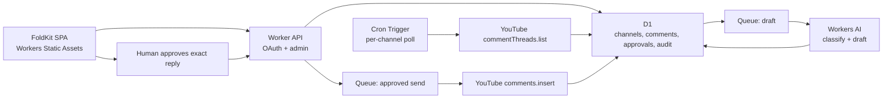

# Remix Request Queue: Platform Research

**Research date:** 2026-08-02  
**Scope:** official Cloudflare, FoldKit, Google, and YouTube documentation only.

## Decision summary

The proposed app is feasible on Cloudflare, with one important boundary: YouTube's push-notification service does **not** publish comment events. A Cloudflare Cron Trigger must poll `commentThreads.list`, persist a watermark/idempotency state in D1, and hand new work to a Queue. AI should create a draft, not publish it automatically; the safest compliant first release requires a human approval immediately before `comments.insert` posts each reply.

Use FoldKit as a **client-side SPA** served by Workers Static Assets, with `/api/*` handled by a Worker. FoldKit's own site says it does not provide SSR; there is therefore no supported “FoldKit SSR on Workers” architecture to rely on.

## Cloudflare component fit

| Component | Official capability and constraint | Architectural implication |
| --- | --- | --- |
| **Workers** | Workers expose HTTP handlers and can call third-party APIs with `fetch`. Current limits include 100,000 requests/day, 10 ms CPU/request, and 50 subrequests/request on Free; Paid defaults to 30 seconds of CPU, configurable to 5 minutes. `waitUntil()` extends work for at most 30 seconds after a response. ([handlers](https://developers.cloudflare.com/workers/runtime-apis/handlers/fetch/), [external APIs](https://developers.cloudflare.com/workers/configuration/integrations/apis/), [limits](https://developers.cloudflare.com/workers/platform/limits/)) | Use a Worker for the FoldKit asset/API origin, OAuth callbacks, admin actions, and YouTube API calls. Do not treat `waitUntil()` as a durable job runner; publish work to Queues. Keep OAuth client credentials and encryption keys in Worker secrets, never in the SPA. |
| **D1** | D1 is SQLite-compatible. Each database processes queries on a single thread; long queries reduce throughput, may queue, and can return `overloaded`. A database can hold up to 10 GB. ([query guidance](https://developers.cloudflare.com/d1/best-practices/query-d1/), [FAQ](https://developers.cloudflare.com/d1/reference/faq/)) | Make D1 the source of truth for connected channels, encrypted token material, comment IDs, ingest watermarks, approval state, send attempts, and audit receipts. Index channel/comment/idempotency keys and keep transactions short. |
| **Queues** | Queues retain messages until they are successfully consumed and support batching, retries, delayed delivery, and dead-letter queues. Delivery order is not guaranteed. Current limits include 128 KB/message, up to 100 retries, 14-day maximum retention, and batches of up to 100. ([overview](https://developers.cloudflare.com/queues/), [delivery model](https://developers.cloudflare.com/queues/reference/how-queues-works/), [limits](https://developers.cloudflare.com/queues/platform/limits/)) | Separate polling, AI drafting, and approved-send work. Every consumer must be idempotent in D1; a queue message is a pointer to durable state, not the state itself. Do not depend on FIFO ordering. |
| **Cron Triggers** | Cron invokes a Worker's scheduled handler in UTC. Trigger changes may take up to 15 minutes to propagate; accounts currently allow 5 triggers on Free and 250 on Paid. ([Cron Triggers](https://developers.cloudflare.com/workers/configuration/cron-triggers/), [limits](https://developers.cloudflare.com/workers/platform/limits/)) | One schedule can scan all enabled channels. Persist per-channel cursors/leases, tolerate duplicate or delayed invocations, and run periodic reconciliation rather than assuming exact execution time. |
| **Durable Objects** | Each object is a globally unique, stateful, single-threaded coordination point with persistent storage; an individual object has a soft limit around 1,000 requests/second. ([rules](https://developers.cloudflare.com/durable-objects/best-practices/rules-of-durable-objects/), [FAQ](https://developers.cloudflare.com/durable-objects/reference/faq/)) | Not required for the first release. Add one keyed by channel only if D1 idempotency is insufficient and strict per-channel serialization, quota coordination, or mutual exclusion becomes necessary. |
| **Turnstile** | Turnstile can protect a form on any site, without using Cloudflare's CDN, but the server must call Siteverify. Tokens are single-use and expire after five minutes. ([overview](https://developers.cloudflare.com/turnstile/), [server validation](https://developers.cloudflare.com/turnstile/get-started/server-side-validation/)) | Protect public onboarding or intake forms and validate hostname/action server-side. Turnstile is neither YouTube authentication nor webhook verification and should not gate routine API-to-API polling. |
| **Workers AI** | Workers AI offers hosted model inference from Workers. It is metered in neurons and model-specific rate limits apply; the current included allocation is 10,000 neurons/day, after which Paid usage is $0.011/1,000 neurons. Requests fail after an applicable limit is reached. ([overview](https://developers.cloudflare.com/workers-ai/), [limits](https://developers.cloudflare.com/workers-ai/platform/limits/), [pricing](https://developers.cloudflare.com/workers-ai/platform/pricing/)) | Put classification and reply drafting behind a Queue and make the feature retryable/fallible. AI output is an untrusted proposal: apply policy checks, store the model/version, and require approval before posting. Pricing and model availability should be rechecked before implementation. |

## FoldKit: verified frontend constraints

“FoldKit” resolves to the official TypeScript frontend framework at [foldkit.dev](https://foldkit.dev/) and the [`foldkit/foldkit`](https://github.com/foldkit/foldkit) repository, not the unrelated Python package with the same name.

- FoldKit describes itself as a TypeScript framework built on Effect and architected like Elm. Its site reported **v0.137.0** on the research date; the repository explicitly labels the project pre-1.0 and warns that minor releases may contain breaking changes. ([official site](https://foldkit.dev/), [official repository](https://github.com/foldkit/foldkit))
- The current scaffolder requires **Node.js 22.22.2+** and pins `effect@4.0.0-beta.102` plus `@effect/platform-browser@4.0.0-beta.102`; FoldKit upgrades can therefore require lockstep Effect beta upgrades. A generated app uses `index.html`, a browser `entry.ts`, and Vite. ([getting started](https://foldkit.dev/get-started/getting-started))
- FoldKit explicitly says it is a **client-side SPA framework**, that teams needing SSR are not a fit, and that static generation is possible only if the team builds it itself. ([official site, “Who it's not for”](https://foldkit.dev/#who-its-not-for))
- Cloudflare Workers can host a generic Vite SPA's built `dist` directory as Static Assets. Configure `assets.not_found_handling = "single-page-application"` so navigation routes fall back to `index.html`; route `/api/*` to Worker code. ([Workers SPA routing](https://developers.cloudflare.com/workers/static-assets/routing/single-page-application/), [Static Assets](https://developers.cloudflare.com/workers/static-assets/))

**Compatibility conclusion:** browser-side FoldKit plus a Workers API is compatible at the deployment boundary, because Workers only serves FoldKit's static Vite output. Neither FoldKit nor Cloudflare documents FoldKit-specific SSR support or an official FoldKit adapter. Do not plan SSR, and do not assume `@foldkit/vite-plugin` and Cloudflare's Vite plugin interoperate until a small build/deploy spike proves it; the lower-risk route is a normal FoldKit production build followed by Wrangler Static Assets deployment.

One routing caveat is especially relevant to OAuth: in SPA mode, browser navigation can prefer `index.html` over the Worker. Put the OAuth callback under an explicitly Worker-first route such as `/api/oauth/callback`, or use the documented client callback page that forwards its query string to an API endpoint. ([Workers SPA navigation behavior](https://developers.cloudflare.com/workers/static-assets/routing/single-page-application/))

## YouTube comment API

### Reading comments

`commentThreads.list` costs **1 quota unit** per call. It can list threads for a `videoId` or all threads related to a channel, returns at most 100 items/page, supports `order=time`, and paginates with `nextPageToken`. An authorized request can also filter `heldForReview`, `likelySpam`, or `published`. It has no `publishedAfter`/`updatedAfter` parameter. ([`commentThreads.list`](https://developers.google.com/youtube/v3/docs/commentThreads/list))

A `commentThread` includes a top-level comment and may include only a **subset** of its replies. Fetching every reply requires `comments.list(parentId=...)`, also 1 unit per page and at most 100 items/page. ([comment thread resource](https://developers.google.com/youtube/v3/docs/commentThreads), [`comments.list`](https://developers.google.com/youtube/v3/docs/comments/list))

Architectural consequences:

1. Scope the initial request intake to new **top-level comments**. Poll newest-first, deduplicate by YouTube comment ID, and continue paging until reaching a persisted known ID/time watermark. Because the API has no server-side time filter, this stopping rule is application logic.
2. Use `allThreadsRelatedToChannelId` when the product truly wants one channel-wide queue; use `videoId` if only designated remix videos are eligible.
3. If replies to old threads can themselves create requests, track those parent IDs and poll them with `comments.list`; `commentThreads.list` does not promise a complete reply feed.
4. Persist ETags/IDs and periodically reconcile recent pages. Re-read the parent immediately before posting so deleted, private, disabled, or no-longer-replyable threads fail safely.

### Posting replies

`comments.insert` creates a reply to an existing top-level comment, costs **50 units**, requires OAuth scope `https://www.googleapis.com/auth/youtube.force-ssl`, and needs `snippet.parentId` plus `snippet.textOriginal`. It can fail when the parent is private/missing, the authenticated viewer cannot reply, the text is invalid/too long, or the account is ineligible. ([`comments.insert`](https://developers.google.com/youtube/v3/docs/comments/insert))

Use an immutable send idempotency key such as `(channel_id, parent_comment_id, approved_reply_revision)`. Record the attempt before calling YouTube and the returned reply ID afterward. Because the API has no idempotency-key parameter, an ambiguous network failure requires readback/reconciliation before retrying.

## No comment webhook: polling is required

YouTube's PubSubHubbub/WebSub push notifications cover only a channel uploading a video or changing a video's title or description. They do **not** cover comments. ([YouTube push notifications](https://developers.google.com/youtube/v3/guides/push_notifications))

Therefore:

- A public Worker webhook endpoint cannot make comment intake event-driven; use Cron polling.
- YouTube push can optionally discover newly uploaded videos, but it does not replace comment polling on those videos.
- Polling faster than the product's response-time requirement only wastes quota. Start around five minutes and make the interval configurable per channel.

## Quota budget

Current default allocation is **10,000 units/day combined for endpoints other than the separately bucketed defaults of 100 `search.list` calls and 100 `videos.insert` calls**. Every request, including an invalid one, costs at least one unit. The default is subject to change and higher quota requires a quota-extension/compliance process. ([Data API overview](https://developers.google.com/youtube/v3/getting-started), [quota calculator](https://developers.google.com/youtube/v3/determine_quota_cost))

For the comment queue, the useful planning equation is:

```text
daily units ~= channel polls + extra pages + reply-list reconciliation + 50 * replies posted
```

At one 1-unit page per channel every five minutes, polling costs `288 × channel_count` units/day. Ten channels consume about 2,880 units before pagination or replies, leaving roughly 7,120 units—at most 142 reply writes if nothing else used the shared bucket. Track actual quota, back off on errors, cap sends per channel/day, and reserve capacity for reconciliation rather than designing to the theoretical maximum.

## OAuth and channel identity

- Background polling/posting requires the OAuth web-server flow with `access_type=offline`; Google returns a refresh token that the server can use when the user is absent. Refresh tokens must be kept in secure persistent storage and can become invalid when access is revoked or expires. ([YouTube OAuth web-server flow](https://developers.google.com/youtube/v3/guides/auth/server-side-web-apps#offline))
- After authorization, call `channels.list(part=id,snippet&mine=true)` and show/store the exact channel ID/title being connected. That method returns channels owned by the authenticated user and costs 1 unit. ([`channels.list`](https://developers.google.com/youtube/v3/docs/channels/list))
- Brand Accounts can expose multiple YouTube channel identities through one Google Account. YouTube warns that API-authenticated third-party apps without channel switching can sign into the wrong channel and recommends setting a default channel in that situation. ([YouTube Brand Account guidance](https://support.google.com/youtube/answer/3046478))
- Google OAuth projects in **Testing** are limited to 100 configured test users, and authorizations—including offline refresh tokens—normally expire after seven days. Public apps requesting scopes Google categorizes as sensitive or restricted must complete the applicable OAuth verification; the Cloud Console identifies each requested scope's category. Plan separate test/production projects, a verified domain, matching app/privacy-policy branding, and a review demonstration before public rollout. ([app audience](https://support.google.com/cloud/answer/15549945), [OAuth verification](https://support.google.com/cloud/answer/13463073))

The onboarding UI should require the user to confirm the read-back channel identity before enabling polling or replies. Store the OAuth client secret and token-encryption key as Worker secrets; store only encrypted refresh-token ciphertext in D1. A disconnect action should revoke access and delete stored user/API data on the policy timetable below.

## Automation, AI, spam, and data-policy guardrails

YouTube's Developer Policies prohibit automating or triggering comments without the user's **prior specific and express consent**. They also require API clients to clearly identify actions that insert/update/delete content, clearly identify the associated YouTube channel, and obtain express consent before execution. ([Developer Policies, authorized actions and abuse](https://developers.google.com/youtube/terms/developer-policies))

The Community Guidelines apply to comments and prohibit high-volume, repetitive, or deceptive comment spam. They also prohibit using automation or AI to flood the platform with high volumes of substantially similar content. AI-assisted replies are not categorically prohibited; abusive volume, repetition, deception, and lack of consent are the risks. ([YouTube Spam Policy](https://support.google.com/youtube/answer/2801973))

For the first release:

- Workers AI may classify a request and draft a reply, but a human must review the original comment, exact target channel, and exact proposed text, then explicitly approve **that send**.
- Reject or flag near-duplicate replies, promotional links, unsupported claims, harassment, and sensitive-personal-data inference. Rate-limit both drafts and posts.
- Never silently regenerate approved text during dispatch; approval binds to a content hash/revision.
- A future fully automatic mode should undergo a YouTube API compliance review and obtain action-specific consent; do not infer that a general OAuth grant alone authorizes autonomous posting.

YouTube API data also carries retention obligations: most authorized and non-authorized API data must be deleted or refreshed within 30 days; stored data should be kept consistent with current YouTube data; users need a deletion mechanism, and requested/account-deletion data must be removed as soon as possible and within seven days. Authorized data may be shown only to the authorizing user or their expressly approved agents. ([Developer Policies, handling API data](https://developers.google.com/youtube/terms/developer-policies#e.-handling-youtube-data-and-content))

Treat YouTube comment text, author metadata, and channel metadata in D1 as refreshable API data. Keep a separate audit record containing internal event IDs, approval actor/time, content hashes, and API receipt IDs where possible; do not preserve stale YouTube payloads indefinitely merely because they are part of an audit log.

## Recommended first-release architecture



Durable Objects are intentionally absent. Add one only after observing a concrete cross-request serialization problem. Turnstile belongs only on exposed human forms. The core safety invariants are D1 uniqueness constraints, immutable approval revisions, queue idempotency, exact channel readback, and post-send reconciliation.
